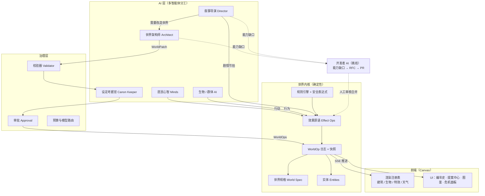
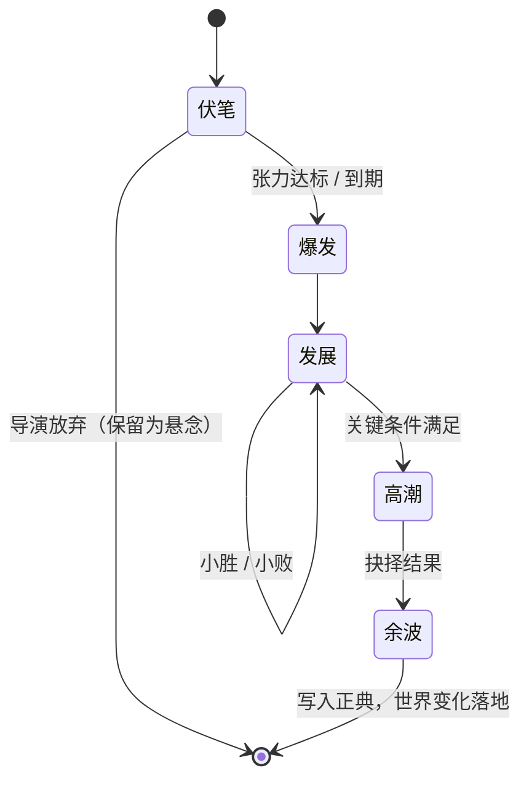
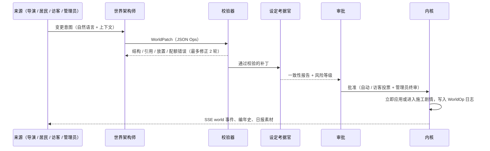

# 云溪镇 2.0：可自我演化的 AI 世界 —— 设计方案

> 状态：**草案 / 待评审**（本文只做设计，不包含代码改动）
> 范围：让 AI 从「扮演居民」升级为「编剧 + 世界建筑师 + 项目协作者」，支持人物穿越、异世界入侵、AI 改写世界框架、AI 创造新能力，以及 AI 反过来为项目本身添砖加瓦。

---

## 0. 一句话概括

**把「写死在代码里的世界」变成「AI 可以提案修改的数据」，由一个确定性的世界内核负责校验和执行；再加上一位叙事导演 AI 负责埋伏笔、推剧情，一位世界架构师 AI 负责改造世界；数据表达不了的新能力，交给离线的开发者 AI 以 PR 的形式补进代码，由人审核后合并。**

三条主线：

| 主线 | 解决什么 | 关键模块 |
| --- | --- | --- |
| **可改写的世界** | 目前地图、地点、天气、节日、居民都写死在代码里，AI 改不了 | 世界规格（World Spec）、实体系统、WorldOp 事件日志、规则引擎 |
| **会讲故事的 AI** | 目前只有「居民各自生活 + 玩家丢事件」，缺少跨天的戏剧结构 | 叙事导演、剧情弧、伏笔/回收、多人场景、穿越者、异界生物 |
| **会成长的项目** | AI 想做但系统做不到的事，要能转化成新功能 | 能力清单、能力缺口日志、开发者 AI → RFC → PR → 人工合并 |

---

## 1. 现状盘点

### 1.1 已有的基础（值得保留）

- **零依赖架构**：Node 内置模块 + 原生 Canvas，部署简单，这个原则继续保持。
- **完整的生成式智能体循环**：规划 → 行动 → 对话 → 记忆 → 反思 → 日记 → 日报，外加旅人对话、心声、事件重规划。
- **程序化美术**：角色精灵由 `look` 参数生成（`public/js/sprites.js`）。这意味着 **AI 只要输出一组参数就能「造」出新角色的外观**，这是实现穿越者和异界生物的天然基础。
- **成熟的公网防护**：限流、预算、审核、提示词隔离（`server/guard.js`）。
- **已有大量未回收的剧情伏笔**：音乐会、水车、表白、热气球、孙婆婆的健康、镜湖宝藏、匿名信、传说的后半段……叙事导演可以把这些线索直接利用起来。

### 1.2 限制 AI 发挥的硬编码点

| 位置 | 硬编码内容 | 带来的限制 |
| --- | --- | --- |
| `server/personas.js:2` `TOWN_LORE`、`:5` `PERSONAS` | 世界观、8 位居民 | 不能新增居民，穿越者无处安放 |
| `server/world.js:16` `BUILDINGS`、`:30` `LOCATION_INFO`、`:44` `buildWorld()` | 建筑、地点、地形 | AI 不能盖房子、改地形、开辟新区域 |
| `server/sim.js:11` `PUBLIC_LOCS` | 可去地点白名单 | 新地点即使存在，居民也不会去 |
| `server/sim.js:16` `WEATHER` | 6 种天气 | 不能出现「血月」「极光」「时空风暴」 |
| `server/sim.js:58`、`public/js/main.js:274` | 萤火节固定在第 4 天，前后端各写一份 | 没有日历系统，AI 不能创造节日 |
| `server/sim.js:480` `startConvo(a, b)` | 对话只能两人 | 开不了「议事会」「全镇大会」这类群像场景 |
| `server/sim.js:745` `godEvent()` | 事件只会让居民「重新规划」 | 玩家事件改变不了世界本身，只是一条消息 |
| `server/sim.js:854-856` `load()` | 只恢复 `PERSONAS` 里的居民，并用初始设定覆盖 `persona` | 新角色读档就丢；居民性格永远不会成长 |
| `public/js/render.js:81` | 可绘制物体类型白名单 | AI 新增的物体类型画不出来 |
| `public/js/render.js:426` `drawBuilding()` | 按固定 `kind` 取墙色和样式 | 新建筑类型没有外观 |
| `server/guard.js:85` | 关键词黑名单包含「丧尸、毁灭、摧毁、爆炸」等 | 「怪物入侵」类剧情会被审核直接拒绝 |
| 居民数据结构 | 没有体力、物品、技能、阵营、信念 | 没有「能力」和「对抗」的承载体 |
| LLM 输出契约 | 只能产出日程、心情、目标、好感、约定 | **AI 没有可以改变世界的「动词」** |

**结论**：现在的 AI 只能在一个固定的舞台上表演。要实现本文目标，关键不是写更长的提示词，而是**给 AI 一套安全的「动词」，并把舞台本身数据化**。

---

## 2. 目标、非目标与设计原则

### 2.1 目标

1. **人物穿越**：来自古代、未来、异世界或平行时空的角色进入小镇；居民也可能被卷走再回来；支持灵魂互换、未来的自己等变体。
2. **异世界入侵**：裂隙、异界生物、危机应对、对抗与谈判、战后重建，世界因此永久改变。
3. **AI 改写世界框架**：新增建筑、地点、地形、天气、节日、阵营、世界法则，全部可审计、可回滚。
4. **AI 创造新能力**：居民可以研究、学习、传授新能力；AI 用「效果原语」组合出新技能、新物品、新玩法。
5. **AI 为项目添砖加瓦**：运行中发现的「能力缺口」自动沉淀，由开发者 AI 转成 RFC 和 PR，经人工审核后合并，扩充原语库，形成闭环。

### 2.2 非目标

- **不让 AI 在运行时生成或执行任意代码**（没有 `eval`，不热加载 AI 写的 JS）。
- 不做即时操作的动作游戏。这仍然是一个「看 AI 自己演」的模拟，玩家是观察者和命运之手。
- 不引入 npm 依赖和构建步骤，不引入数据库（JSON 存档 + JSONL 日志足够）。

### 2.3 六条设计原则

1. **AI 提案，内核裁决。** AI 永远不直接改状态，只输出带类型的操作（Op）；内核负责校验、执行和记录。
2. **数据即能力。** 新能力优先用「数据 + 原语组合」表达，原语不够时才走代码 PR。
3. **伏笔先于爆发。** 所有重大事件都要有铺垫，并尽量回收已有线索。怪物不会毫无征兆地出现。
4. **一切可回滚。** 世界结构的变更完整记录、可重放；动态状态按快照回滚。
5. **LLM 只在关键节拍出场。** 高频行为（生物移动、规则触发）由规则驱动，LLM 只做决策和叙事，成本可控。
6. **保留温馨底色。** 可以冒险，但不残酷：没有死亡，伤害可以修复，怪物也有自己的故事。

---

## 3. 总体架构



**数据流总结**：各路 AI 只产出「意图」，意图被编译成 **效果原语（Effect Ops）** 或 **世界补丁（WorldPatch）**，经过校验和审批后写成 **WorldOp** 记录进日志，再由内核应用到世界规格和实体上，最后通过 SSE 推送给前端。

---

## 4. 世界内核：让世界可以被改写

### 4.1 世界规格（World Spec）

把硬编码内容全部抽取成一份可校验的 JSON 规格。现在的云溪镇就是默认规格 `spec/yunxi.base.json`，由现有的 `personas.js` 和 `world.js` 机械转换而来，**第一阶段重构后游戏表现与现在完全一致**。

```jsonc
{
  "id": "yunxi",
  "specVersion": 2,
  "meta": { "name": "云溪镇", "rating": "adventure", "storyteller": "voyage" },
  "lore": {
    "summary": "云溪镇是一个依山傍水的小镇……",
    "pillars": ["小镇的温馨底色不可改变", "镜湖是两个世界的交界"]   // 不可被 AI 修改的核心设定
  },
  "calendar": {
    "weekdays": ["周三", "周四", "周五", "周六", "周日", "周一", "周二"],
    "events": [
      { "id": "firefly", "name": "萤火节", "emoji": "🏮", "day": 4, "from": "18:00", "to": "23:00",
        "location": "pier", "vfx": "festival_lanterns", "hint": "晚上大家会在镜湖边放灯许愿" }
    ]
  },
  "weather": {
    "sunny": { "name": "晴朗", "emoji": "☀️", "weight": 50 },
    "bloodmoon": { "name": "血月", "emoji": "🌕", "weight": 0, "nightOnly": true,
      "render": { "tint": "#8a1c2c", "tintAlpha": 0.25, "moon": { "color": "#e0404a", "size": 1.6 } } }
  },
  "regions": [{ "id": "town", "generator": "yunxi-v1", "seed": 20260924, "size": [64, 44] }],
  "locations": { "cafe": { "name": "星光咖啡馆", "emoji": "☕", "desc": "……", "indoor": "cafe", "public": true } },
  "buildings": [{ "id": "cafe", "name": "星光咖啡馆", "kind": "cafe", "x": 34, "y": 6, "w": 7, "h": 7, "roof": "#c4553f" }],
  "personas": [ /* 由 PERSONAS 转换 */ ],
  "creatures": [], "items": [], "abilities": [], "rules": [], "factions": [], "arcs": [],
  "params": { "walkSpeed": 3.2, "maxConvos": 3, "dayEnd": "22:30" }
}
```

- **地图 = 生成器（种子）+ 补丁叠加**。`buildWorld()` 保留为 `yunxi-v1` 生成器，保证原地图逐格一致；AI 新增的建筑和地形变化作为补丁叠加在上面。
- 规格有 JSON Schema 风格的校验器（自己实现一个小型的，不引入依赖），所有写入都必须通过校验。
- `lore.pillars` 是**不可修改的支柱设定**，任何 AI 补丁都不能与之矛盾，用来防止世界观在长期演化中跑偏。

### 4.2 实体与组件

把「居民」泛化为「实体」，通过可选组件组合出不同角色：

| 实体类型 `kind` | 典型组件 | 说明 |
| --- | --- | --- |
| `resident` 居民 | persona、mind、body、inventory、abilities、beliefs | 现在的 8 位居民 |
| `traveller` 穿越者 | 同上 + origin、anchor（归途条件）、knowledgeGap | 可转为常驻居民 |
| `creature` 生物 | body、behavior、faction、look(bodyPlan)，可选 mind | 首领有独立心智，普通个体共享群体心智 |
| `structure` 构筑物 | hp、effects、owner、ttl | 瞭望塔、结界、陷阱、临时避难所 |
| `portal` 裂隙 / 传送门 | stage、spawnTable、corruption | 可以被封印、扩张或稳定 |
| `item` 掉落物 | itemRef、owner | 落在地上的灯笼、月石等 |

新增的通用组件：

```jsonc
"body":      { "hp": 100, "stamina": 100, "courage": 60, "conditions": ["受惊"] },
"inventory": { "lantern": 2, "wood": 5 },
"abilities": ["firefly_ward"],
"beliefs":   [{ "about": "rift", "claim": "湖里真的有门", "confidence": 0.7, "source": "wang" }],
"growth":    [{ "day": 6, "change": "在危机中戒了酒", "traitDelta": "更沉稳" }]
```

`growth` 解决了现在 `load()` 用初始设定覆盖 `persona` 的问题：**核心人设保持不变，经历带来的成长以增量方式叠加**，写进提示词的 `personaBlock`。

### 4.3 WorldOp、事件日志与回滚

所有对世界的修改都是一条 WorldOp：

```jsonc
{ "seq": 1042, "t": 8123, "op": "addBuilding", "args": { /* … */ },
  "cause": { "by": "architect", "proposal": "wp_0012", "origin": "agent:zhao" } }
```

- 写入 `data/ops.jsonl`（追加写），每个游戏小时做一次快照 `data/snapshots/`，保留最近 N 个。
- **LLM 的输出作为 Op 参数被记录下来**，所以重放世界结构变更时不需要再次调用 LLM，结果是确定的。
- **回滚粒度**：世界结构（规格）可以精确回到任意一条 Op 之前；动态状态（位置、日程、对话）按快照回滚。
- 管理员可以执行「⏳ 时光回溯」；以后还可以扩展成「时间线分支」（从快照另起一条世界线），这本身也可以成为「时间循环」剧情的底层机制。

### 4.4 效果原语（Effect Ops）

效果原语是 AI 的「动词表」。每个原语包含：参数 schema、前置校验、应用函数、成本和权限等级。第一版大约 30 个：

| 类别 | 原语 |
| --- | --- |
| 位置 | `moveTo` `teleport` `push` `spawn` `despawn` `setRegion` |
| 属性 | `stat`（加 / 设 / 夹取）`addTag` `removeTag` `setMood` `addCondition` |
| 认知 | `addMemory` `addBelief` `spreadNews`（按半径 / 关系传播，可失真）`setGoal` `addCommitment` `triggerReplan` |
| 关系 | `affinity` `setFaction` `factionRelation` |
| 物品 | `giveItem` `takeItem` `craft` |
| 世界 | `setTile`（限定类型）`placeStructure` `damageStructure` `repairStructure` `setWeather` `setFlag` `schedule`（延时执行）`arc`（推进剧情弧）|
| 能力 | `grantAbility` `revokeAbility` `cooldown` |
| 表现 | `vfx`（预设 + 参数）`bubble` `sound` `log` `toast` `cameraHint` |

**永远没有的原语**：永久删除居民、修改 `lore.pillars`、执行代码、访问文件和网络。

### 4.5 规则引擎与安全表达式

世界法则用「触发 → 条件 → 效果」来声明：

```json
{
  "id": "rule_light_repels_shadow",
  "name": "萤火驱影",
  "when": { "every": "10m" },
  "if": "e.kind == 'creature' && hasTag(e, 'shadow') && nearLight(e, 3)",
  "then": [
    { "op": "push", "target": "e", "from": "nearestLight", "dist": 2 },
    { "op": "stat", "target": "e", "stat": "hp", "add": -5 }
  ],
  "source": "canon:legend-lake"
}
```

- 触发器：`every`（周期）、`enter` / `leave`（进出区域）、`time`（时刻）、`weather`（天气变化）、`calendar`（节日）、`op`（某类 Op 发生后）、`stat`（数值越过阈值）。
- 条件使用自己实现的**安全表达式语言**（手写小型解析器，**不使用 `eval` 或 `Function`**）：只允许白名单里的变量和函数（`hasTag`、`near`、`nearLight`、`count`、`day`、`hour`、`weather`、`stat`……），限制表达式长度和求值步数，没有属性链访问，也没有循环。
- 每条规则每个 tick 的执行次数和影响的实体数有上限，防止 AI 写出「雪崩」规则。

### 4.6 可调世界法则（参数旋钮）

「修改世界框架」最安全的方式，是把内核里的常量暴露成**有上下限的参数**，让规则和补丁可以调节它们：

| 参数 | 当前值 | 允许范围 | 可能的剧情用途 |
| --- | --- | --- | --- |
| `walkSpeed` | 3.2 | 2 ~ 5 | 大雾中步履迟缓；节日时脚步轻快 |
| `dayEnd` / 睡眠窗口 | 22:30 | 21:00 ~ 次日 01:00 | 危机期间彻夜守望 |
| `maxConvos` | 3 | 1 ~ 6 | 节日里人声鼎沸 |
| 相遇对话概率 | 0.22 | 0.05 ~ 0.6 | 恐慌时大家闭门不出 |
| 天气权重 | 见 `autoWeather` | 0 ~ 100 | 裂隙开启后更容易起雾 |
| 反思阈值 | 40 | 20 ~ 80 | 重大事件后大家更爱思考 |
| 夜间快进 | 开 | 开 / 关 | 夜袭剧情需要关闭 |

规则可以写成 `{"op":"param","name":"walkSpeed","mul":0.8,"while":"weather == 'fog'"}`，条件不再满足时自动恢复。

---

## 5. AI 角色体系

原来只有「居民大脑」一种角色。现在拆分为五种各司其职的 AI：

### 5.1 居民心智 2.0

**(1) 行动空间：从「只会排日程」到「会做事」**

日程条目增加可选的 `act` 字段，复用现有的日程和约定机制。条目开始时，内核执行对应的行动：

```jsonc
{ "start": "14:00", "end": "17:00", "location": "library", "activity": "查县志找裂隙线索", "emoji": "📜",
  "act": { "type": "research", "topic": "镜湖裂隙的弱点" } }
```

| 行动 | 说明 |
| --- | --- |
| `go` / `talk` | 现有能力 |
| `gather` | 召集多人场景（议事会、聚会） |
| `use` | 使用能力，比如 `use firefly_ward @ farm` |
| `give` / `craft` / `build` | 赠送、制作、建造（建造会发起一个施工项目，完工时提交 WorldPatch）|
| `research` | 研究某个课题，完成后可能解锁新能力或揭示设定 |
| `investigate` / `guard` / `shelter` / `flee` | 调查、守卫、避难、逃离 |

LLM 只能从**当前可用**的行动里选（按地点、物品、能力、状态过滤），输出不合法时内核拒绝并退回到普通日程。

**(2) 多人场景（Scene）**：一次 LLM 调用写出 N 人的群像戏。参与者各自检索记忆并压缩成摘要，场景输出包括台词、决议、分工，以及每个人的记忆和好感变化。用于议事会、节日、谈判、告别等场合。现有的两人对话是它的特例。

**(3) 分层目标**：人生目标 → 篇章目标（跟随剧情弧，持续数天）→ 今日目标 → 当下意图。规划时带上当前篇章目标，让居民的行为在多天内保持连贯。

**(4) 信念与传言（心智理论）**：`beliefs` 记录「我认为某事是真的，有多确定，听谁说的」。`spreadNews` 在传播过程中可能失真或被怀疑。于是会出现「周慧不相信有怪物」「小乐深信不疑」这样的分歧，冲突自然产生。

**(5) 性格成长**：反思时可以产出 `growth` 条目（每次最多 1 条，幅度有限，不能违背核心人设），比如铁柱在危机后戒了酒。

### 5.2 叙事导演（Director）

借鉴 RimWorld 的「叙事者」思路，导演负责整个小镇的戏剧节奏。

**张力模型（不调用 LLM，每游戏小时计算一次）**

```
张力 T（0~100）= 35 × 威胁度（活跃敌对生物 / 上限，裂隙阶段）
               + 20 × 冲突度（负好感关系、未化解的争执）
               + 20 × 悬念度（未回收的剧情线程、未揭示的秘密）
               + 15 × 匮乏度（物资、士气缺口）
               + 10 × 节日 / 天气加成
沉闷度 B = 距离上一个重要节拍的游戏时长
```

**三种叙事者人格（管理员可切换）**

| 叙事者 | 风格 | 张力目标曲线 | 适用场景 |
| --- | --- | --- | --- |
| 🌸 静水 `gentle` | 以日常为主，小波澜 | 峰值 ≤ 45，每 3~4 天一件小事 | 公网默认 |
| 🗺️ 远航 `voyage` | 每季（7 个游戏日）一个完整剧情弧 | 伏笔 → 峰值约 80 → 回落 | 推荐 |
| 🎲 掷骰 `chaos` | 随机、高频、跨题材 | 随机 | 本地娱乐 |

**决策**：当 `|T − 目标| > δ` 或 `B > 阈值` 时，导演调用一次 LLM（使用较强的模型，最多每 2~3 游戏小时一次），从下面的选项中选择：

`noop` 按兵不动 · `foreshadow` 埋伏笔 · `complicate` 添麻烦 · `escalate` 升级 · `relief` 喘息 · `resolve` 收束 · `launchArc` 开启剧情弧（套用模板，或即兴创作新弧）

导演的输出是一组「节拍（Beat）」，每个节拍会被编译成效果原语。例如一个伏笔节拍 = 给 1~2 位居民 `addMemory(type: 'omen')` + 在湖面播放 `vfx(ripple_purple)` + 写一条日志。

**剧情线程看板**：初始化时从人设和记忆中提取未解决的线索（音乐会、水车、表白、热气球、孙婆婆的健康、宝藏、匿名信、传说后半段、大山的女儿），导演的首要任务之一是**把它们编进剧情并回收**。

**剧情弧生命周期**



**玩家事件改由导演处理**：`godEvent` 不再只是一条让大家重新规划的消息，而是作为「外部扰动」交给导演，由导演改编成与当前剧情相符的节拍（在访客权限配额内，可以生成实体或世界补丁）。比如访客发布「天上掉下来一个人」，导演可能把它变成一次穿越者登场。

### 5.3 世界架构师（Architect）

负责把「世界需要改变」这个意图变成 **WorldPatch**。意图可以来自导演、居民（施工完成、研究完成）、访客或管理员。

```jsonc
{
  "id": "wp_0012",
  "title": "在码头旁修建瞭望塔",
  "origin": "agent:zhao",
  "motive": "议事会决定加强湖岸警戒，铁柱主动请缨",
  "scale": "minor",
  "ops": [
    { "op": "addBuilding", "id": "watchtower", "name": "湖畔瞭望塔", "kind": "tower",
      "size": [3, 3], "place": { "near": "pier", "within": 6, "avoid": ["water", "road", "spots"] },
      "style": { "wall": "stone", "roof": "#6b4a2b", "sign": "🔭", "lightAtNight": true } },
    { "op": "addLocation", "id": "watchtower", "name": "湖畔瞭望塔", "emoji": "🔭",
      "desc": "可以俯瞰镜湖的木石塔，夜里点着灯", "indoor": "watchtower", "public": true },
    { "op": "addCanon", "text": "第 6 天，镇民在码头旁修建了瞭望塔。", "tags": ["瞭望塔", "镜湖"] }
  ],
  "construction": { "by": ["zhao"], "hours": 8, "needs": { "wood": 20 } }
}
```

- **语义化放置**：AI 不写坐标，只描述「靠近哪里、多大、避开什么」，由内核的放置求解器寻找合法位置，开辟连到道路的小路，并**校验全图连通性**（复用 `world.js` 中的连通性检查）。找不到位置就驳回，并附上原因。
- **施工剧情化**：`construction` 字段让补丁先变成居民日程里的施工任务，完工时才真正落地，世界变化因此成为故事的一部分。
- **能力清单（Capability Manifest）**：架构师的提示词里会注入一份自动生成的清单，列出当前可用的 Op、建筑风格、生物体型、特效预设、参数范围。清单里没有的东西，AI 必须输出 `{"op": "gap", ...}`（见第 7 节），**不能凭空编造**。

**提案流水线**



### 5.4 设定考据官与世界正典（Canon）

- **正典库** `canon`：一组结构化事实（文本、标签、来源 Op、可见范围、是否为秘密、知情者）。检索方式与现有的记忆检索一致（双字组相似度，无需向量模型）。
- 所有 WorldPatch、剧情弧节拍、穿越者设定在落地前，都要检索相关正典并做一次**一致性审查**，检查它是否与支柱设定或既有事实冲突、名称是否重复、是否破坏温馨底色。
- **秘密与揭示**：比如「传说后半段」是秘密正典，只有孙婆婆知道。满足揭示条件时，它通过 `spreadNews` 进入其他人的信念。
- 前端提供「📜 设定集」，观众可以阅读小镇的演化史（秘密条目在揭示前显示为「？？？」）。

### 5.5 生物与群体 AI

- **日常行为由规则驱动（不调用 LLM）**：原型包括 `wander` 游荡、`thief` 偷窃、`chaser` 追逐、`guard` 守卫、`swarm` 聚群、`skulk` 潜行、`curious` 好奇，复用现有的 A* 寻路。
- **群体心智**：同一族群共享一个决策，每 1~2 游戏小时调用一次 LLM，决定「今晚去哪、目标是什么、要不要撤退」。
- **首领心智**：首领是完整的 LLM 角色，**可以对话**，访客和居民都能与它交谈，这是「谈判结局」的基础。
- **遭遇结算**：生物与居民相遇时进行对抗检定（属性 + 能力 + 物品 + 同伴援助 + 随机），结果只有「驱散 / 吓退 / 偷走东西 / 僵持 / 受惊 → 送诊所」，**不会死亡**。普通遭遇只用规则结算；有名有姓的角色或首领参与的遭遇，才批量交给 LLM 叙述（每小时有上限）。

### 5.6 模型路由与预算

- 增加 `MODEL_FAST` 和 `MODEL_SMART` 两档（不配置时都回落到 `MODEL`）：内心独白、群体心智、遭遇叙述用快模型；导演、架构师、考据官、多人场景用强模型。**生产环境确定为 `MODEL_FAST=glm-5.3-flash`、`MODEL_SMART=glm-5.3`**（当前线上运行的是 `glm-5.3-flash`）。
- 按模块分配预算，例如 `LLM_BUDGET_SPLIT=residents:55,director:15,architect:10,creatures:10,reserve:10`。某个模块超额时降级为规则驱动，不影响其他模块。
- 支持 `response_format: json_schema` 的接口优先使用它（启动时探测）；不支持时沿用现有的 `extractJSON` 和修复重试。

新增调用的粗估（仅供量级参考，以实测为准）：

| 模块 | 每游戏日调用次数 | 说明 |
| --- | --- | --- |
| 叙事导演 | 4 ~ 10 | 平静期很少，剧情弧活跃期较多 |
| 世界架构师 + 考据官 | 2 ~ 6 | 受每日补丁配额限制 |
| 群体心智 | 0 ~ 12 | 只在有生物时 |
| 遭遇叙述 / 首领对话 | 0 ~ 15 | 有上限 |
| 多人场景 | 1 ~ 4 | 替代部分两人对话 |
| 穿越者 | 约等于 1 位居民 | 同时最多 2 位 |

预计平静期的消耗比现在增加不到 15%，剧情弧高潮期增加 40% ~ 70%。预算和降级机制保证不会失控。

---

## 6. 玩法系统

### 6.1 人物穿越

**五种变体**

| 变体 | 描述 | 实现要点 |
| --- | --- | --- |
| 外来穿越者 | 古代侠客、1926 年的少女、未来的机械师、异世界骑士、平行时空里的「另一个云溪镇」居民 | 新建 `traveller` 实体 |
| 居民被卷走 | 某位居民跌入裂隙，离开数日 | 离开期间由 LLM 生成「离屏叙事」，回来时带着物品、能力和性格变化 |
| 未来的自己 | 20 年后的王小乐回来发出警告 | 复制已有居民并修改年龄、外观和记忆，与本人同时存在 |
| 灵魂互换 | 两位居民互换身体，限时 | 交换 `mind` 组件，外观不变，喜剧效果 |
| 时间循环 | 「今天又重来了一遍」 | 基于快照回溯，居民保留模糊的既视感记忆 |

**穿越者定义**（由导演决定、架构师生成、考据官审查）：

```jsonc
{
  "kind": "traveller", "id": "tr_aying", "name": "阿萤", "age": 17,
  "origin": { "type": "past", "era": "1926 年的云溪镇", "via": "rift" },
  "arrival": { "at": "pier", "day": 4, "time": "21:30", "vfx": "rift_burst" },
  "persona": "倔强、礼貌、说话带着旧式腔调，对新事物既害怕又好奇",
  "goal": "找到她在湖边等待的人，并回到自己的年代",
  "knowledgeGap": ["手机", "咖啡", "短视频", "热气球", "电灯"],
  "knows": ["古法制灯", "镜湖传说的真相"],
  "look": { "skin": "#f5d6c0", "hair": "#1b1b22", "hairStyle": "braid", "shirt": "#6f8fb5",
            "pants": "#2f3b55", "acc": ["hairpin", "qipao"] },
  "anchor": { "returnWhen": "在满月之夜于码头放出原初之灯", "mayStay": true },
  "secrets": [{ "text": "那封匿名信是她写的", "revealWhen": "affinity(he) >= 40" }],
  "bindings": ["canon:legend-lake", "thread:anonymous-letter"]
}
```

- **认知错位**：`knowledgeGap` 写进她的提示词，让她真实地误解新事物（「这方匣子里怎么住着人？」），居民教她、她也教居民，关系在这个过程中建立。
- **身份揭示**：秘密满足条件时揭示，与既有剧情线程（匿名信）相互交织。
- **去留**：满足 `returnWhen` 后上演一场告别场景，留下信物和正典条目；或者选择留下，成为常驻居民（属于大改，按审批规则处理）。
- **限额**：穿越者同时最多 2 位，居民总数最多 16 位。

### 6.2 异世界入侵

**裂隙（Portal）**：阶段依次为 `微裂 → 开启 → 扩张 → 稳定 / 封闭`。每个阶段有自己的刷怪表和侵蚀半径（地面染色，少量地块变成不可通行），可以被能力、仪式或谈判改变。

**生物图鉴**（AI 生成，考据官审查）：

```jsonc
{
  "id": "shade_wisp", "name": "影灵", "origin": "镜湖彼岸的暗月界",
  "tags": ["shadow", "otherworld"], "temperament": "mischievous",
  "look": { "bodyPlan": "wisp", "size": 0.8, "palette": ["#2b2250", "#6b5bd6"],
            "eyes": "glow", "eyeColor": "#f5e663", "trail": "smoke" },
  "stats": { "hp": 30, "speed": 3.6, "courage": 20 },
  "behavior": { "archetype": "thief", "targets": ["item:lantern", "loc:farm"],
                "fleeFrom": ["light", "song"], "active": ["19:00", "05:00"] },
  "weakness": ["强光", "萤火灯", "歌声"],
  "lore": "暗月界的光正在熄灭，它们循着萤火而来",
  "mind": "swarm"
}
```

注意 `weakness` 里的「歌声」和「萤火灯」：导演会有意识地把**已有线索变成解法**，比如林晓雨的音乐会和何月的歌声、萤火节的灯、铁柱的热气球。

**小镇状态**：`士气`、`物资`（木材、灯笼、食物）、`防御`（构筑物）、`恐惧`（汇总值）。这些数值会影响居民的规划，比如宵禁、结伴出行、闭门不出。

**危机应对**：导演召开议事会（多人场景）进行分工，但每位居民**是否服从由其心智根据性格决定**（铁柱冲在前面，周慧坚持安全第一，小乐一心想直播）。职业自然对应分工：

| 居民 | 危机中的角色 |
| --- | --- |
| 赵铁柱 | 打造灯炮、陷阱、瞭望塔 |
| 周慧 | 照料受惊和晕倒的人，诊所临时变成医护站 |
| 林晓雨 | 咖啡馆变成避难所，组织物资 |
| 苏墨 | 在图书馆研究弱点，解锁新能力 |
| 王小乐 | 侦察和直播（也可能帮倒忙） |
| 何月 | 在酒馆鼓舞人心，她的歌声也许正是武器 |
| 孙婆婆 | 讲出传说真相，是解开谜团的钥匙 |
| 陈大山 | 守护农场，水车改装成「灯轮」 |

**三种结局方向**（由议事会、访客投票和检定结果共同决定）：封印、谈判共存、以智取胜。每种结局都会**永久改变世界**：新地点「裂隙遗迹」、新节日、新居民（留下来的影灵）、新阵营关系、写入正典。

**内容分级**（见第 8 节）：`cozy` 模式下入侵表现为「捣蛋精灵偷西瓜、吹灭灯笼」，`adventure` 模式下才有真正的危险和对抗。

### 6.3 能力系统（Ability DSL）

```jsonc
{
  "id": "firefly_ward", "name": "萤火结界", "emoji": "🏮",
  "desc": "点燃一圈萤火灯，暗影生物无法靠近",
  "learn": { "via": ["research@library", "teach"], "requires": "has(item.lantern)" },
  "target": { "type": "area", "radius": 3 },
  "cost": { "stamina": 20, "items": { "lantern": 1 } },
  "cooldown": "2h",
  "effects": [
    { "op": "spawn", "archetype": "structure.light_ward", "at": "target", "ttl": "1h" },
    { "op": "vfx", "preset": "glow_ring", "color": "#ffd76a", "radius": 3 }
  ],
  "aiHint": "附近有带 shadow 标签的生物时使用",
  "source": "research:su:day5"
}
```

- **能力的来源**：研究（`research` 行动完成后，由架构师根据正典和原语生成能力定义）、传授（居民之间教学）、物品、穿越者带来的技艺、剧情奖励。
- 能力只能由效果原语组合而成，受数值上限约束（范围、伤害、持续时间）。校验器会拒绝越界的定义。
- 居民规划时会在提示词里看到自己掌握的能力及 `aiHint`，于是能在合适的时机主动使用。

### 6.4 世界改造与扩张

| 改造类型 | 例子 | 级别 |
| --- | --- | --- |
| 新建筑 / 地点 | 瞭望塔、避难所、纪念碑、新店铺 | 小改 |
| 地形 | 湖面结冰、裂隙坑、新桥、焦土复绿 | 大改 |
| 新天气 | 血月、极光、流星雨、时空风暴（用已有粒子和色调组合而成）| 小改 |
| 新节日 | 双月节、重建日 | 小改 |
| 新规则 / 法则 | 萤火驱影、满月时时间流速变慢 | 大改 |
| 新阵营 | 暗月界难民、守夜人协会 | 小改 |
| 新区域（可选，后期）| 北山、异界口袋地图（通过传送门进入）| 大改 |

64×44 的地图空地有限。新增建筑受空地配额约束；后期可以通过**多区域**扩展，比如为「暗月界」单独生成一张口袋地图，居民和穿越者可以经由裂隙往返。

### 6.5 场景模块：AI 自定义玩法

除了一次性的剧情弧，AI 还可以设计**可重复的玩法模块**，例如「每周日全镇集市拍卖会」「守夜轮值」「读书会」：

```jsonc
{
  "id": "scene_night_watch", "name": "守夜轮值",
  "trigger": { "calendar": "daily", "time": "21:00", "while": "flag.rift_open" },
  "participants": { "pick": 2, "prefer": "courage >= 50", "rotate": true },
  "location": "watchtower",
  "brief": "两人在瞭望塔守夜，聊心事，留意湖面动静",
  "outputs": ["memory", "affinity", "belief", "spotCreature"]
}
```

`brief` 是一段场景描述，**只作为素材放进固定的系统提示词**，不能改写系统指令；`outputs` 只能映射到效果原语。这样 AI 相当于在不写代码的前提下「新增了一个功能」。

---

## 7. 自我进化闭环：AI 为项目添砖加瓦

这是本方案中最「元」的部分：**运行中的 AI 发现系统能力不足 → 沉淀为需求 → 开发者 AI 写出 RFC 和代码 → 人审核合并 → 系统获得新能力 → 能力清单自动更新 → 运行中的 AI 开始使用它。**


**1. 能力缺口（Gap）**：AI 想做但清单里没有的事，按统一格式记录：

```json
{ "op": "gap", "need": "让生物能附身到物体上（比如附在稻草人身上移动）",
  "why": "剧情需要影灵躲进稻草人里偷袭农场", "by": "director", "arc": "arc_rift" }
```

内核把它写入 `data/gaps.jsonl`，按相似度去重（复用 `memory.js` 的双字组相似度）并累计次数。剧情会用现有原语降级处理，不会卡住。

**2. AI 心愿单**：管理员面板按出现次数和影响面排序展示缺口，可以标记「采纳 / 忽略」。

**3. `mise run evolve`（离线脚本 `tools/evolve.js`）**：读取已采纳的缺口、编年史和能力清单，由 LLM 生成 RFC（动机、设计、Op schema、渲染需求、测试点），写入 `docs/rfcs/NNNN-*.md`。

**4. 实现环节（已确定：不做自动化）**：流水线**只生成需求文档**，不自动写代码、不自动开 PR。由维护者阅读 RFC 后，自行或借助编码助手在扩展点上实现，经 `mise run check`、`mise run test` 和模拟回放后合并。

**5. 扩展点契约**：让 AI 写的代码局限在可审查的小范围内：

```js
// server/ext/*.js —— 每个文件注册一个或多个扩展
registerEffectOp('possess', { schema, validate, apply, cost, level: 'minor' });
registerRuleFn('isPossessed', (ctx, e) => Boolean(e.possessing));
// public/js/ext/*.js
registerBodyPlan('scarecrow_possessed', drawFn);
registerVfx('possess_swirl', drawFn);
```

**6. 内容反哺**：一季结束后，可以把演化出的精彩内容（生物、能力、建筑、节日）导出为 Mod 包 `spec/mods/*.json`，经人工挑选后以 PR 形式纳入官方默认内容。

**安全边界（硬性要求）**

- 运行中的服务器**永远不持有** GitHub 写权限，也不加载未合并的代码。进化流水线与运行时在职责和凭据上完全隔离。
- 不自动合并。PR 必须通过 CI 和人工审核。
- 扩展代码只能通过注册表接入，不能修改内核和 `guard.js`。修改这些文件的 PR 需要额外审查。

---

## 8. 治理与安全

### 8.1 审批分级

| 等级 | 例子 | 本地模式 | 公网模式 |
| --- | --- | --- | --- |
| 微调 | 新物品、记忆种子、预设内的天气和特效 | 自动 | 自动 |
| 小改 | 新建筑 / 地点（配额内）、新能力、新生物种类、新节日、场景模块 | 自动 | 访客投票 → 管理员终审 |
| 大改 | 地形改造、新区域、全局规则、新常驻居民、移除或替换已有内容 | 管理员确认 | 访客投票 → 管理员终审 |
| 代码级 | 新效果原语、新渲染类型 | 开发者 AI 只生成 RFC → 人工实现与合并 | 同左 |

**配额**（均可配置）：每游戏日小改 ≤ 3、大改 ≤ 1；活跃生物 ≤ 40；穿越者同时 ≤ 2；居民总数 ≤ 16；新增建筑 ≤ 12；规格文件 ≤ 512KB。

### 8.2 内容分级 `STORY_RATING`

已确定：**公网也允许开启 `adventure`**；`epic` 仍只限本地或管理员。

| 分级 | 冲突表现 | 怪物 | 伤害 |
| --- | --- | --- | --- |
| `cozy` 温馨 | 误会、小麻烦 | 捣蛋精灵：偷瓜、吹灭灯、藏东西 | 没有 |
| `adventure` 冒险 | 危险、对抗、紧张 | 有威胁，会被击退、驱散、封印 | 受惊或晕倒 → 送诊所 |
| `epic` 史诗（仅本地或管理员）| 重大损失、牺牲（不含血腥描写）| 强大的首领 | 重伤、建筑毁坏（可修复）|

**审核规则拆分**：把 `guard.js` 里的 `BLOCK` 拆成两类：

- **硬禁区**（任何分级都拦截）：色情、血腥细节、自残、现实政治、真实人物、违法指导、仇恨。
- **软禁区**（随分级放开）：怪物、入侵、战斗、击退、裂隙等冒险词汇在 `adventure` 及以上允许；「屠杀」「尸体」等仍然拦截。
- LLM 审核员的提示词随分级变化；导演的输出同样经过分级约束，并坚持**非致死原则**（没有任何 Op 能永久移除居民，「离开小镇」也总是可逆的）。

### 8.3 二阶提示词注入防护

AI 生成的名字、描述、正典会在之后被反复写进提示词，形成新的注入面，比如访客事件 → 导演 → 生物名 → 以后的所有提示词。对策：

- 所有 AI 生成的字符串写入规格前，都要经过 `sanitize` 和关键词检查，并有字段长度上限。
- AI 生成的内容**只出现在 user 消息的「」素材区**，永远不进入 system 消息；沿用并推广现有的 `GUARD` 声明。
- 结构化字段（id、kind、op）只接受白名单字符集。
- 前端渲染 AI 文本时一律转义（沿用 `esc()`）。

### 8.4 访客参与

| 访客可以 | 限制 |
| --- | --- |
| 与居民、穿越者、会说话的怪物首领交谈 | 沿用聊天限流 |
| 发布事件（由导演改编成节拍）| 沿用事件限流和审核 |
| 在剧情高潮的抉择点投票 | 每个 IP 每次抉择 1 票 |
| 为世界补丁投票（公网模式可选）| 每个 IP 每天 N 票 |
| 送出「祝福」（小幅加成，比如给某人勇气 +10）| 每个 IP 每天 1 次 |

管理员另外拥有：切换叙事者人格和内容分级、审批补丁、时光回溯、手动开启或结束剧情弧、处理 AI 心愿单。

---

## 9. 前端表现

- **渲染注册表**：把 `render.js` 里的 `switch (o.type)` 和 `drawBuilding` 的 `kind` 分支改成注册表，并提供**兜底渲染**，保证 AI 新增的任何东西都能显示：
  - 未知建筑 `kind` → 按 `style` 参数程序化生成（墙体材质、屋顶颜色和形状、招牌 emoji、烟囱、夜灯）；
  - 未知物体 → emoji 精灵加底座阴影；
  - 未知配饰 → 忽略，不报错。
- **程序化生物精灵**：在 `sprites.js` 旁边新增 `creatures.js`，提供体型模板 `humanoid / blob / wisp / quadruped / bird / golem / serpent`，参数为尺寸、调色板、眼睛、附属物（角、翼、尾、光环）和动画（浮动、扑翼、蠕动），并带缓存。
- **穿越者外观**：`look.acc` 扩充 `robe`、`armor`、`helmet`、`crown`、`horns`、`wings`、`hairpin`、`qipao`、`visor`、`cape`；`hairStyle` 扩充 `braid`、`ponytail`、`topknot`。
- **特效预设 `vfx.js`**：`glow_ring`、`beam`、`burst`、`rift`（旋涡）、`shield_dome`、`sparkle_trail`、`screen_tint`、`shake`、`ripple`，全部参数化。
- **天气组合**：新天气 = 已有粒子系统 + 色调 + 天体参数，比如血月 = 夜色偏红 + 红月，时空风暴 = 雨 + 紫色调 + 闪电。
- **新面板**
  - 🌀 **编年史**：剧情弧与世界变化的时间线（每条可追溯到 Op 和提案）
  - 🛠 **提案中心**：补丁差异预览（在小地图上高亮新建筑的位置）、审批和投票
  - 📜 **设定集**：正典
  - 👾 **图鉴**：生物与穿越者
  - ⚔️ **危机面板**：张力值、裂隙阶段、士气、物资、防御
  - 🌱 **AI 心愿单**（管理员）
  - 🎭 **叙事设置**（管理员）
- **SSE 新事件**：`world`（补丁生效，前端增量重建静态层）、`entity`（生成 / 移除）、`arc`（阶段变化）、`vfx`（一次性特效）、`proposal`、`vote`。`tick` 快照里增加 `entities` 的紧凑数组，保留 `agents` 字段以兼容旧前端。
- **日历驱动的节日**：删除 `main.js:274` 的 `day === 4` 硬编码，改为读取规格里的 `calendar`，由服务端下发。

---

## 10. 示范剧本：第一季《镜湖裂隙》

用一个完整的季来说明各个系统如何协同（叙事者 `voyage`，分级 `adventure`）。

| 游戏日 | 阶段 | 剧情 | 涉及的系统 |
| --- | --- | --- | --- |
| 第 1 天 | 伏笔 | 深夜，镜湖泛起一圈圈紫色涟漪。王小乐拍到了视频，陈大山发现西瓜被啃过，地上留着发光的小脚印 | 导演 `foreshadow` → `vfx(ripple)`、`addMemory(omen)`、`spawn`（1 只影灵，只在夜间出没）|
| 第 2 天 | 伏笔 | 小乐的视频在镇上传开，周慧认为是恶作剧，孙婆婆听了却沉默不语 | 信念分化、`spreadNews` 失真 |
| 第 3 天 | 伏笔 | 苏墨在图书馆翻到县志残页；孙婆婆终于讲出传说后半段：百年前的少女放灯，是为了封住湖底的「门」 | 秘密正典揭示、剧情线程「传说后半段」回收 |
| 第 4 天 | 爆发 | 萤火节放灯时，湖心的裂隙张开，影灵群涌出扑灭河灯。一位身穿旧式衣裳的少女「阿萤」从裂隙中跌了出来 | `launchArc`、`portal` 实体、穿越者登场、日报号外 |
| 第 5 天 | 发展 | 月光酒馆召开紧急议事会，大家分工。苏墨和阿萤合力研究古法灯阵，**解锁新能力「萤火结界」**；铁柱提议修建瞭望塔 | 多人场景、`research` 行动、架构师生成能力、WorldPatch 审批与施工 |
| 第 6 天 | 发展 | 影灵夜袭农场，大山的水车被改装成「灯轮」击退了它们。晓雨收留了一只受伤的小影灵，发现它们怕的是黑暗，不是人：暗月界的光正在熄灭。何月认出阿萤的信笺和匿名信是同一种字迹 | 遭遇结算、导演 `relief`、冲突由对抗转向谈判、线程「匿名信」推进 |
| 第 7 天 | 高潮 | 「暗月守门人」现身湖心，索要「原初之灯」。居民议事、访客投票：<br/>**A 封印**：阿萤带灯回到过去，小镇多了一个伤感而美丽的传说<br/>**B 共存**：交还灯火，两界开通「月之渡口」，影灵成为新居民，新增「双月节」<br/>**C 智取**：铁柱的热气球载着灯阵升空，重新点亮暗月（高风险检定） | 首领心智对话、投票、抉择检定、热气球线程回收 |
| 余波 | 余波 | 日报特刊；新地点「裂隙遗迹」；阿萤的去留；铁柱在危机中戒了酒；苏墨终于写完了小说的结局 | 正典写入、`growth`、世界补丁落地、下一季的伏笔 |

这一季几乎把所有已有伏笔（音乐会、歌声、热气球、水车、传说、匿名信、苏墨的小说、铁柱喝酒）都编进了主线。**这正是导演「剧情线程看板」要达到的效果。**

---

## 11. 工程实现

### 11.1 目录结构（重构后）

```
server/
  index.js  guard.js（分级审核）  llm.js（模型路由、分模块预算、json_schema）
  sim.js              瘦身为调度器：主循环 + 编排各子系统
  kernel/
    spec.js           规格加载、校验、默认规格生成、迁移
    entities.js       实体与组件
    ops.js            WorldOp 定义、应用、日志、快照、回滚
    effects.js        效果原语注册表
    rules.js          规则引擎
    expr.js           安全表达式（手写解析器，不使用 eval）
    placement.js      语义化放置求解 + 连通性校验
    world.js          原 world.js：yunxi-v1 生成器 + 补丁叠加
  mind/
    resident.js       原 sim.js 中的规划、独白、对话、反思、日记
    scene.js          多人场景
    beliefs.js        信念与传言
    memory.js
  story/
    director.js  arcs.js  threads.js  traveller.js  invasion.js  encounter.js
  worldai/
    architect.js  canon.js  governance.js  manifest.js  gaps.js
  ext/                人工审核后的扩展（开发者 AI 的 PR 落点）
spec/
  yunxi.base.json     默认世界规格
  arcs/*.json         剧情弧模板（入侵、穿越、灵魂互换、时间循环……）
  mods/*.json         可选 Mod 包
public/js/
  render.js（注册表化）  sprites.js  creatures.js  vfx.js  ui.js（新面板）  ext/
test/                 node:test（零依赖）+ fixtures/
tools/evolve.js       能力缺口 → RFC
docs/design/  docs/rfcs/
```

### 11.2 与现有代码的挂接点

| 现有位置 | 改动 |
| --- | --- |
| `Town.start()` 主循环 | 增加 `kernel.tick(dt)`（生物、规则、构筑物），每游戏小时调用 `director.tick()` |
| `planDay` / `replan` 提示词 | 加入可用行动、能力、篇章目标、「小镇当前局势」（剧情弧摘要）|
| `timeBlock()` / `festivalHint()` | 改为读取规格中的日历 |
| `locListText()` / `PUBLIC_LOCS` | 改为读取规格中的 `locations`（`public: true`）|
| `personaBlock()` | 加入 `body`、能力、信念、`growth` |
| `finishConvo()` | 输出里可以带「世界点子」，比如「我们该建个瞭望塔」，交给架构师排队 |
| `godEvent()` | 交给 `director.ingest()` |
| `snapshot()` / `initPayload()` | 加入 `entities`、`calendar`、`spec` 摘要 |
| `save()` / `load()` | 升级到 v2（见下）|

### 11.3 存档迁移

- 存档 v2：`{ v: 2, spec, snapshot, entities, arcs, canon, proposals, flags, … }`，外加 `ops.jsonl` 和 `snapshots/`。
- **v1 → v2 自动迁移**：用当前常量生成默认规格，把 `agents` 映射为 `resident` 实体，其余字段原样保留。迁移前自动备份（沿用 `save-*.bak.json` 的做法）。
- 读档时不再用初始设定覆盖 `persona`，改为「初始人设 + `growth` 增量」。

### 11.4 性能

- 实体数量有上限；生物移动复用 A* 寻路，按帧分摊（每 tick 最多重算 K 条路径）。
- 放置建筑后只增量重算可达性，不重建整张地图；前端收到 `world` 事件后只重绘受影响的静态层区域。
- `tick` 广播沿用 10Hz，生物用紧凑数组编码；视野外的生物降低更新频率。

### 11.5 测试（`mise run test`，使用 `node:test`，零依赖）

- 单元测试：表达式解析器（包括恶意输入）、校验器、放置求解器（连通性）、效果原语、规则引擎上限、分级审核。
- 迁移测试：v1 存档样例 → v2 → 再存档，保证数据不丢失。
- **无头模拟回放**：使用录制好的 LLM 响应（`test/fixtures/llm/*.json`），以 30 倍速跑 7 个游戏日，断言以下不变量：没有居民卡住、没有居民被移除、实体数不超过上限、所有补丁都有日志、回滚后规格一致。（2026-09-26 已实现：`test/replay.test.js`，录制回复在 `test/fixtures/llm/responses.json`，可用 `LLM_RECORD` 从真实模型重新录制。）
- 这套回放同时是开发者 AI 所提 PR 的 CI 门槛。

---

## 12. 实施路线图

| 阶段 | 内容 | 验收标准 |
| --- | --- | --- |
| **P0 地基** ✅ | 规格抽取（行为不变）、实体模型、WorldOp 日志与快照、存档 v2 迁移、渲染兜底、测试框架 | 游戏表现与现在一致；`mise run test` 通过；旧存档可以无损迁移 |
| **P1 动词** ✅ | 效果原语、安全表达式、规则引擎、能力 DSL、居民行动空间、`body` 和物品栏、特效预设、参数旋钮 | 手写的「萤火结界」可以被居民通过 LLM 自主使用 |
| **P2 导演** ✅ | 张力模型、剧情线程看板、剧情弧引擎、伏笔节拍、多人场景、`godEvent` 改由导演处理、信念传播 | 无头跑 7 天，能自然产生至少 1 个有伏笔、有回收的剧情弧 |
| **P3 穿越与入侵** ✅ | 穿越者系统、生物系统（体型精灵、行为原型、群体和首领心智）、裂隙、遭遇结算、分级审核、危机面板、图鉴 | 《镜湖裂隙》可以从头玩到尾，三种结局都能触发 |
| **P4 架构师** ✅ | WorldPatch、放置求解、考据官与正典、提案中心、审批和投票、时光回溯、新天气、新节日、新建筑 | AI 新增的建筑能正确渲染、可以走进去、居民会使用；回滚正确 |
| **P5 自我进化** ✅ | 能力清单、缺口日志、心愿单、`tools/evolve.js`、扩展点注册表、RFC 模板 | 一个真实的缺口生成 RFC，人工实现合并后被运行中的 AI 使用 |
| **P6 扩展** ✅ | 多区域 / 异界口袋地图、时间线分支、访客化身、Mod 导出；随 AI 负载调速、每游戏日用量统计 | 居民能经渡口往返暗月界；分支互不影响；访客化身被居民看见并记住；Mod 可在新小镇加载 |

**P0 落地说明**：默认规格没有单独存成 `spec/yunxi.base.json`，而是由 `server/kernel/spec.js` 从现有常量生成（`mise run spec` 可以打印），避免两份数据不同步；实体模型目前以「居民 + 通用组件」的形式落地，其他实体类型随 P3 加入；首批 WorldOp 为 `setParam`、`setMeta`、`addCanon`、`addCalendarEvent`、`addWeather`。

**P1 落地说明**：
- 效果原语首批 16 个：`stat`、`condition`、`mood`、`memory`、`belief`、`affinity`、`giveItem`、`takeItem`、`flag`、`spawn`、`vfx`、`say`、`log`、`paramMod`、`grantAbility`（位置类原语 `moveTo` / `teleport` / `push` 以及 `spreadNews`、`schedule` 随 P2 / P3 加入）。
- 规则触发器：`every`、`at`、`weather`、`enter`；每次触发最多影响 12 个实体，条件出错的规则会被停用。
- 能力 7 个（萤火结界、暖心咖啡、问诊、月光之歌、扎萤火灯、讲古、摘西瓜），物品 4 种，构筑物 1 种，默认规则 2 条。
- 行动 `use` / `give` / `teach` / `research` 挂在日程条目的 `act` 字段上；内心独白可以输出 `use` 当场使用能力。
- 新增 WorldOp：`addItem`、`addStructure`、`addAbility`、`addRule`。
- `llm.setMock()` 用于测试：用模拟模型验证了「居民通过 LLM 自主使用能力」和「按日程研究学会能力」两条链路。

**P2 / P3 落地说明**（完整汇报见 `docs/reports/2026-09-24-p2-p3.md`）：
- 叙事导演每游戏小时计算张力；决策最多每 2 游戏小时一次（玩家事件优先），每次最多 3 个节拍；导演可用的节拍与剧情弧专属节拍分开，导演不能刷怪、让角色登场或发起投票。
- 《镜湖裂隙》以数据模板实现，节拍时间相对开弧日计算；没有 LLM 时使用预设台词与立场，整季也能走完。
- 穿越者与守门人以 `addPersona` 写入世界规格（新增 `setPersonaStatus` 管理离开 / 回来），守门人可以与居民、访客对话。
- 与设计的差异：生物图鉴目前是 3 种手写生物（AI 生成新生物留给 P4 的架构师）；世界补丁审批（投票 → 管理员终审）在 P4 实现，P3 的投票只用于剧情抉择。

**P4 落地说明**（汇报见 `docs/reports/2026-09-24-p4.md`）：
- 新建筑以 `added: true` 叠加在 `yunxi-v1` 生成结果之后，不改变原有随机序列；坐标在提案阶段由求解器确定并写进操作参数，因此重放是确定的。
- 施工中的居民去的是 `place.near` 指定的地点（工地本身不是地点）。
- 回溯只做「整点快照」粒度，没有做「撤销某一条世界操作」：撤销单条操作会让依赖它的角色、剧情状态失去一致性。
- 新 WorldOp：`addBuilding`；导演新增节拍 `propose`；居民对话输出新增可选字段 `idea`。

**P5 落地说明**（汇报见 `docs/reports/2026-09-24-p5.md`）：
- 能力缺口保存在存档里（而不是单独的 `data/gaps.jsonl`），`mise run evolve` 直接读存档；缺口与需求文档的对应关系写在 `data/evolve.json`。
- 按已确认的决定，流水线只生成需求文档；没有接 GitHub Action。
- 扩展点只做了服务端（效果原语、表达式函数）；前端的特效 / 体型注册表留待需要时再加。
- 第一个走完闭环的能力：RFC 0001 → `server/ext/go-to.js`（效果 `goTo`）。

建议顺序：**P0 → P1 → P2 → P3**，先做出一个可玩的完整季，再做 P4、P5 的开放式改造。P0 是纯重构，风险最低，但决定了后面所有阶段能否顺利推进。

---

## 13. 风险与对策

| 风险 | 对策 |
| --- | --- |
| 世界观在长期演化中跑偏、自相矛盾 | 支柱设定不可修改；考据官审查；补丁配额；随时回滚 |
| Token 成本失控 | 模块预算与降级；模型分档；生物行为由规则驱动；导演低频调用 |
| 公网滥用或出现不当内容 | 分级 + 硬禁区；大改只限管理员；二阶注入防护；非致死原则 |
| 冒险剧情和温馨基调冲突 | 叙事者人格 + 分级；怪物也有自己的故事；冲突可以转向谈判与共存 |
| `sim.js` 单文件过大，改动风险高 | 已按职责拆到 `server/sim/`（2026-09-26），由回放测试与 CI 护航 |
| AI 生成的内容渲染不出来 | 渲染注册表 + 兜底渲染 + 能力清单约束 |
| LLM 输出的复杂 JSON 不稳定 | 优先使用 `json_schema`；校验失败带错误信息重试（最多 2 轮）；失败时降级为规则驱动 |
| 自我进化流水线引入坏代码 | 运行时与流水线隔离；只允许通过扩展点接入；CI 回放测试；人工审核，不自动合并 |

---

## 14. 已确认的决策（2026-09-24）

| # | 问题 | 决定 |
| --- | --- | --- |
| 1 | 内容分级 | 公网也允许开启 `adventure`（`epic` 仍只限本地或管理员）|
| 2 | 世界改造审批 | 公网：访客投票，管理员最终决策；本地：小改自动、大改管理员确认 |
| 3 | 自我进化闭环 | 只生成需求文档（RFC），不自动开 PR |
| 4 | 模型 | `MODEL_SMART=glm-5.3`，`MODEL_FAST=glm-5.3-flash`（当前线上为 `glm-5.3-flash`）|
| 5 | P3 优先级 | 人物穿越与怪物入侵一起做，即《镜湖裂隙》完整一季 |

仍按默认方案推进的事项：地图暂时保持 64×44 单张地图（多区域放到 P6）；穿越者可以永久留下、居民可以暂时离开小镇，均按「大改」审批。
