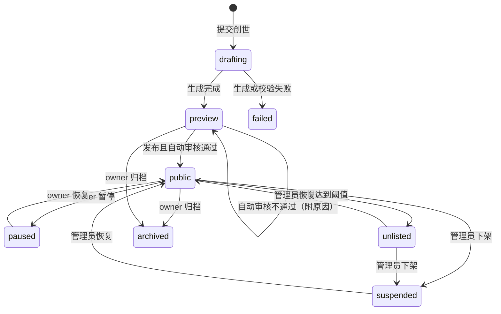

# 云溪镇 4.0：多世界、创世与账号 —— 设计方案

> 状态：**草案 / 待评审**（本文只做设计，不包含代码改动）
> 前置：[2.0 可自我演化的 AI 世界](ai-world-evolution.md)、[3.0 完全自主迭代](autonomous-evolution.md)
> 范围：把「云溪镇」从写死在代码里的唯一世界，变成众多世界中的一个；任何人都能注册，被授予「创世权限」的用户可以把一篇童话或小说变成一个公开的、由 AI 自主演化的世界。所有世界共用一套模型配置，排同一个队。

---

## 0. 一句话概括

**世界是数据（世界包 + 操作历史），不是代码；运行中的世界是一个 `Town` 实例，由世界管理器按需加载；人是账号，能做什么由授予的权限决定；所有 AI 调用只进一个调度器，调度器决定先后，账本决定记在谁头上。**

四条主线：

| 主线 | 解决什么 | 章节 |
| --- | --- | --- |
| 世界包与创世 | 世界从代码常量变成可替换的数据；小说/童话 → 世界包 | §3、§4 |
| 账号与权限 | 公开注册；管理员授予「创世权限」；owner 管理自己的世界 | §5 |
| 多世界运行时 | 一台服务器同时托管多个世界，按需加载、无人时休眠 | §6 |
| 统一 AI 调度 | 所有世界、创世、进化共用一个队列、一套配置、一本账 | §7 |

另外两条是既有机制的推广：决策权交给世界 owner（§8）、进化引擎全局化并按世界可选开启（§9）。

---

## 1. 原则：简单，而不是简陋

项目不再要求零依赖。取舍的标准换成 *Simple Made Easy*：

- **简单（simple）**＝概念之间不交织；**容易（easy）**＝顺手、熟悉。我们追求前者，不为后者引入交织。
- **引入依赖的条件**：它替我们去掉一个本来要自己维护的概念，并且不带来新的运行时部件。反例：Redis、消息队列、独立的认证服务、构建步骤——它们都会把「部署」和「功能」绑在一起。
- **不简陋**：该有的都要有——会话可吊销、密码正确哈希、配额可观测、下架立即生效、每个决定有审计记录。

### 1.1 现状中交织在一起的东西，以及本方案如何拆开

| 交织 | 现在 | 拆开后 |
| --- | --- | --- |
| 身份 × 网络地址 × 权限 | `isAdmin` 靠共享令牌；访客 ID 取自可伪造的请求头；限流按 IP（`server/guard.js:41`、`:46`） | **身份**（账号 / 会话）、**授权**（角色 + 授予）、**配额**（按主体计数）是三个独立的函数 |
| 世界 × 进程 | 全局唯一的 `town`，SSE 广播给所有连接（`server/index.js:34`） | **世界**是值（世界包 + 操作日志）；**运行时**是 `Town` 实例；**托管**是世界管理器 |
| 世界 × 代码 | `defaultSpec()` 直接导入 `personas.js`、`world.js`、`story/content.js` 的常量 | 内核只认世界包；云溪镇迁成 `worlds/yunxi/` |
| 调用点 × 调度策略 | 每个调用点自己决定 `priority: true/false`、自己检查 `budgetLeft()`（`server/llm.js:131`） | 调用点只声明**做什么**（label）；调度器决定**何时**；账本决定**记在谁头上** |
| 进化引擎 × 独立队列 | 守护进程导入 `server/llm.js`，得到的是另一份队列和并发（`evolution/llm.js:3`） | 守护进程经 IPC 向主进程申请调用，进入同一个队列 |
| 配置 × 进程环境 | 约 58 个环境变量散落在各文件，默认值和范围各写各的，不校验，改动要登录服务器重启 | 一张设置声明表是唯一出处：读取、校验、面板、文档都由它生成；值的来源只有「环境变量 > 面板 > 默认值」三层（§14） |
| 决策权 × 管理员令牌 | 投票、提案、插件上线的终审都是 `requireAdmin` | 决策队列询问「这个世界的终审人是谁」，由一个策略函数回答 |
| 内容尺度 × 常量 | `canon.js` 的支柱破坏词、`guard.js` 的审核提示词写死「温馨小镇」 | 平台底线（常量，不可覆盖）与世界支柱（世界包里的数据）分开 |

### 1.2 依赖选择

| 依赖 | 用来替代什么 | 理由 |
| --- | --- | --- |
| `hono` + `@hono/node-server` | `server/index.js` 里手写的路由、Cookie、SSE 拼接 | 多世界后路由按 `/api/w/:world/*` 挂子应用，认证、世界解析、限流写成中间件；基于 Web 标准的 `Request/Response`，测试可以直接 `app.request()`，不用起端口 |
| `zod`（v4） | 散落在各处的手写校验函数 | 一份定义同时用于：请求体校验、世界包 / 插件清单校验、`z.toJSONSchema()` 生成 LLM 结构化输出约束和能力清单文档。**渐进迁移**：新代码用它，旧校验在被改动时顺手替换 |
| `node:sqlite`（内置） | —— | 账号、会话、授予、世界登记、举报、审计、用量账本。约 8 张表，直接写 SQL，不用 ORM |
| `node:crypto` 的 `scrypt`（内置） | —— | 密码哈希。argon2 需要原生模块，会带来编译问题，收益不值得 |

明确**不引入**：ORM、JWT（令牌吊销和会话是一回事，JWT 会把它们拆成两件难事）、Passport 一类的认证框架、Redis / BullMQ（进程内调度足够，多一个服务就多一个故障点）、前端框架和构建步骤（Canvas 主程序和新增的表单页继续用原生 ES Modules + 模板字符串，与 `public/js/ui/*` 的现有写法保持一致）。

---

## 2. 已确认的决策（2026-09-27）

| # | 问题 | 决定 |
| --- | --- | --- |
| 1 | 注册方式 | 公开注册；注册后只是普通用户，没有任何特殊权限 |
| 2 | 世界如何上架 | 自动审核通过即公开；管理员可以随时下架 |
| 3 | 同时运行的世界上限 | 默认 4，设置项 `MAX_ACTIVE_WORLDS`（§14） |
| 4 | 世界内的终审 | owner 终审；超时后由 AI 裁决官决定 |
| 5 | 进化引擎 | 全局引入，每个世界在创世时选择是否开启 |
| 6 | 依赖 | 不再要求零依赖，以「简单」为准（§1） |
| 7 | AI 调用 | 仍由全局配置统一排队（§7） |
| 8 | 互动额度 | 按账号计：每小时聊天 45 句、事件 4 个；另有按 IP 的兜底上限（§5.4） |
| 9 | 谁能与世界互动 | **只有注册用户**。游客只能观看；现身、聊天、心声、发布事件、改天气、投票、举报都需要登录（§5.4、§5.6）。*2026-09-27 修订：原决定为「游客可以互动」* |
| 10 | 世界 id | 用户自选短名，用于分享链接；冲突时提示换一个；发布后不可修改（§4.4） |
| 11 | 世界磁盘上限 | 由管理员配置：全局默认值 + 按用户（授予）覆盖 + 按世界覆盖（§6.4） |
| 12 | 互动身份 | 玩家在所有世界里都用账号昵称出现；昵称全站唯一；居民记住的是账号，不是名字字符串（§5.6） |
| 13 | 配置管理 | 所有设置在管理员面板中修改；只有启动必需的 6 项必须用环境变量；环境变量仍可覆盖任意设置；面板可一键重启，启动失败自动回退（§14） |

---

## 3. 世界包：世界是数据

### 3.1 结构

```
worlds/<worldId>/                 仓库里的官方世界（例如 yunxi）
data/worlds/<worldId>/pack/       用户创世生成的世界
  world.json      规格：设定、支柱、日历、作息、参数、分级、叙述口吻（对应现在的 defaultSpec() 返回值）
  bible.json      世界圣经：人物、地点、物件、规则、时间线、文风；每条事实带原文出处
  map.json        区域布局图（语义），由生成器确定性地展开成瓦片
  arcs/*.json     剧情弧（由原著情节改编；云溪镇的《镜湖裂隙》迁到这里）
  source/         原文分块与索引（仅供创世与运行时检索，不对外提供）
```

`world.json` 在现有 spec 的基础上补充以下字段，替换代码里的硬编码：

| 字段 | 替代的硬编码 |
| --- | --- |
| `voice`：叙述者身份、编年体裁（日报 / 公告 / 歌谣 / 起居注）、UI 文案 | `cognition.js:176`《云溪日报》、`index.html` 标题、`modals.js` 示例事件 |
| `rhythm`：`{ plan: "05:30", diary: "22:15", chronicle: "22:45" }` | 规划、日记、日报的固定时刻 |
| `era`：`{ tech: "medieval", forbidden: ["手机"] }` | 无（新增，考据官用它检查时代错误） |
| `lore.pillars`、`lore.breakers` | `canon.js:8` 写死的 `PILLAR_BREAKERS` |
| `regions[].generator` + `map.json` | `buildWorld()` 里写死坐标的 `yunxi-v1` 和 `moonrealm-v1` |
| `bodyPlans`（部件组合） | `BODY_PLANS = ['wisp','hound','warden']` |

### 3.2 地图：语义布局 + 确定性生成器

LLM 不直接输出瓦片，只输出语义布局；由生成器负责落地：

```jsonc
{ "regions": [{ "id": "forest", "biome": "dark_forest", "size": "large",
    "places": [{ "id": "grandma_house", "kind": "cottage", "style": { "roof": "thatch", "wall": "#8a6a4a" } }],
    "links": [{ "to": "village", "via": "path", "length": "long" }] }] }
```

- 生成器分三步：区域图 → 布局求解 → 地形笔刷。biome 决定地块调色板和装饰物分布；连通性沿用现有的 `checkPlacement` 与寻路校验。
- `yunxi-v1` 保留为「手工布局」生成器，保证云溪镇逐格不变。
- 渲染从按 `kind` 分支（`public/js/render/terrain.js`、`objects.js`）改成按参数绘制：建筑 `{roofShape, wallMaterial, height, sign, decor[]}`，物体和生物用部件组合。
- 新增 WorldOp `addRegion`、`linkRegions`：运行中的 AI 也能开辟区域，不用再为暗月界那样的新区域写代码。

### 3.3 存档与世界包的关系

- 存档写入 `worldId` 和世界包的内容哈希。读档 = 世界包 → 按世界启用的插件覆盖层 → 操作历史重放（与现在的顺序相同，只是底座换成世界包）。
- 世界包更新（例如 owner 在预览期修改了人物）后哈希变化，旧存档仍按 WorldOp 重放；重放不过的操作照现有逻辑跳过并记日志。

---

## 4. 创世管线

### 4.1 阶段

| 阶段 | 做什么 | 产物与关口 |
| --- | --- | --- |
| G1 阅读 | 分块、层级摘要（段 → 章 → 全书）、建索引 | `source/`；长篇只在这一步读全文，之后只检索 |
| G2 圣经 | 抽取人物（性格、目标、秘密、关系、外貌参数）、地点、物件、规则、时间线、文风 | `bible.json`；每条带出处，缺出处的事实标为「改编」 |
| G3 改编 | 按用户选项确定开局时间点、角色分层、分级、支柱、忠实度 | 改编说明（给用户看，也给考据官看） |
| G4 生成 | `world.json`、`map.json`、剧情弧、能力、物品、叙述口吻 | 全部通过 zod 结构校验和 WorldOp 语义校验 |
| G5 验证 | 考据官对照圣经审查；无头影子试跑 1 个游戏日；采样审核生成内容 | 指标：卡住率、对话重复率、设定冲突数、审核拒绝数 |

创世在主进程里运行（它只调用 LLM 和做数据校验，不产生代码，不需要沙箱），调用走统一调度器的 P3 级（§7）。

### 4.2 让角色活在原著里，而不是复读原著

- **知识边界**：角色的初始记忆只来自自己在场的原文片段（检索时按 `witnesses` 过滤）。
- **原著引力**：把原著的关键情节做成剧情弧里的「命运节点」，是软吸引子，不是硬脚本。忠实度三档：`faithful`（尽量回到原著）/ `drift`（允许偏离，关键节点以变形方式出现）/ `free`（原著只当背景）。导演提示词里加入「当前偏离度」。
- **偏离即分支**：重大偏离可以自动分出时间线（复用 `server/timelines.js`），形成「如果……」的平行世界。
- **角色分层**：主角走完整认知循环；配角只做日程和对话；群众由规则驱动，共享一个群体心智（与现有的生物系统同一模式）。`MAX_PERSONAS` 改为分层计数。

### 4.3 面向用户的流程

```
创世向导
 1. 来源：粘贴文本 / 上传 .txt / 只写一段设定描述
 2. 声明：来源是公版作品或本人有权使用（写入审计）
 3. 选项：世界短名（§4.4）、开局时间点、忠实度、分级（受授予范围限制）、主角数量、是否开启自主进化（§9）
 4. 提交 → 进入全局队列；页面显示排队位置、当前阶段、已用 token
 5. 预览：人物卡、地图、剧情弧、设定集；每一项可以编辑，或者「重新生成这一项」
 6. 发布 → 自动审核（§10）→ 公开
```

- 原文上传单独开接口，流式读取，上限按授予的配额；其余接口保持 8KB 的请求体上限。
- 原文先经过关键词粗筛，再按段落抽样送审核模型；审核不过则不进入创世。
- 原文中夹带的指令一律视为素材（沿用现有提示词隔离）。更根本的防线是：**创世的产物只能是数据**，必须通过结构和语义校验；创世本身不产生代码。

### 4.4 世界短名

世界 id 由用户在创世向导里自选，链接形如 `/w/little-red/`。

- 格式：`^[a-z][a-z0-9-]{2,31}$`（小写字母开头，3~32 位，只含小写字母、数字和短横线）。
- 保留字不可用：`admin`、`api`、`w`、`auth`、`static`、`new` 等路由词，以及官方世界的 id。
- 输入时实时检查是否可用（`GET /api/worlds/id-available?id=`），冲突时提示换一个；提交创世时在数据库里以唯一约束占用，失败的创世任务会释放占用。
- 短名本身也要过关键词检查，和世界名的审核走同一个流程。
- **发布后不可修改**，保证分享出去的链接长期有效；发布前（`drafting` / `preview`）可以改。世界归档并清理后，短名冷却 30 天才能被重新使用，避免旧链接指向别人的新世界。

---

## 5. 账号与权限

### 5.1 三个独立的函数

```
identify(req)   → { user | null, sessionId }        谁在请求
authorize(who, action, world?) → true | 理由        能不能做
quota(who, bucket) → { ok, remaining, retryAfter }  还剩多少
```

路由中间件依次调用这三个函数；业务代码不再直接读请求头或 IP。

### 5.2 角色与授予

| 角色 | 获得方式 | 能做什么 |
| --- | --- | --- |
| 游客 | 不登录 | 只能观看公开世界：地图、居民详情、关系网、编年、剧情面板；沉浸模式完整可用 |
| 用户 | 公开注册 | 在任意公开世界现身、聊天、化作心声、发布事件、改天气、投票、举报；聊天记录跟着账号走 |
| 管理员 | 超级管理员授予，或用 `ADMIN_TOKEN` 认领 | 用户管理、授予 / 收回权限、下架世界、全局调度与预算 |

**「创世」是授予，不是角色。** 授予记录带配额和有效期：

```jsonc
{ "userId": "u_8f3a", "cap": "genesis", "grantedBy": "u_admin", "at": "2026-09-27T10:00:00Z",
  "expiresAt": null, "note": "童话改编试点",
  "quota": { "maxWorlds": 2, "maxSourceChars": 60000, "genesisTokens": 400000,
             "dailyWorldTokens": 150000, "ratings": ["cozy", "adventure"], "diskMB": 200 } }
```

- `quota` 的缺省值来自环境变量（`GENESIS_MAX_WORLDS`、`WORLD_DISK_MB` 等），管理员授予时可以一键使用默认值，也可以逐项修改。
- `diskMB` 是这位用户**每个世界**的磁盘上限（§6.4）。
- 以后新增的授予（例如给某位用户更大的配额）用同一张表，不改角色体系。

### 5.3 世界内角色

只有一种：**owner**（创建者）。可以修改世界设置、暂停 / 恢复、开关进化、终审本世界的决策（§8）、归档世界。不设协管角色；需要时再以授予的形式加入。

### 5.4 注册、登录、会话

| 项 | 方案 |
| --- | --- |
| 密码 | `scrypt`（N=2^15, r=8, p=1）+ 每用户随机盐；比较用 `timingSafeEqual`；长度 ≥ 10，并对照一个小型弱口令表 |
| 会话 | 随机 32 字节令牌，数据库只存 SHA-256；Cookie `HttpOnly; Secure; SameSite=Lax`；30 天滑动过期；支持「登出所有设备」；禁用账号时立即删除其全部会话 |
| CSRF | 写接口只接受 `application/json`（现有）+ 校验 `Origin` 头 |
| 用户名 / 昵称 | 用户名（登录用）3~20 位，只允许字母数字和下划线；昵称（在世界里显示的名字）规则见 §5.6 |
| 防刷 | 注册按 IP 限流（默认每小时 3 个）；登录失败按账号和 IP 双重指数退避；可选接入人机验证（`CAPTCHA_SECRET`，不配置则不启用） |
| 找回密码 | 第一版不接邮件：管理员在后台生成一次性重置链接 |
| 管理员认领 | 首次启动且没有管理员账号时，`ADMIN_TOKEN` 的持有者可以把自己的账号升为超级管理员；之后令牌保留为应急入口，每次使用都写审计 |
| 本地模式 | 非公网模式（`PUBLIC_MODE` 未开启）下不要求注册：所有请求视为一个内置的本地管理员账号，昵称取 `LOCAL_NICKNAME`（默认「旅人」），开发和单机体验不受影响 |

**互动必须登录。** 游客点击任何互动入口（现身、搭话、心声、发布事件、天气、投票）时，弹出登录 / 注册框，完成后自动继续刚才的操作，不打断体验。注册只需要用户名、昵称和密码。

互动额度按账号计。公开注册意味着账号本身不值钱，所以同时保留按 IP 的兜底上限，防止批量注册绕过：

| 限制 | 默认值 | 变量 |
| --- | --- | --- |
| 每个账号每小时聊天 | 45 句（另有每分钟 4 句的突发限制） | `RATE_CHAT_PER_HOUR` |
| 每个账号每小时发布事件 | 4 个 | `RATE_EVENT_PER_HOUR` |
| 同一 IP 下所有账号合计 | 单账号额度的 3 倍 | `RATE_IP_FACTOR` |
| 全镇事件冷却 | 按世界计算，沿用现值 | `EVENT_GLOBAL_COOLDOWN_SEC` |

内容审核按所在世界的分级进行；这些规则在官方世界和用户创建的世界里完全相同。

这一改动让现有的一块代码可以整体删除：可伪造的 `x-visitor` 请求头、按访客 ID 隔离的聊天记录（`a.visitorChats[vid]`）、按 IP 限制「每人一个化身」，都换成账号 id。

### 5.6 互动身份：一个账号，一个名字

**要解决的问题**：现在的化身名字只在「同时在场」的旅人之间查重（`server/avatars.js:24`），离开后别人可以用同一个名字现身。居民的记忆里存的是名字字符串（「旅人「小明」对我说……」），于是不同时段、不同的人会被居民当成同一个「小明」。

**做法：把「是谁」和「叫什么」拆开。** 居民记住的是账号，名字只是显示用的。

| 项 | 规则 |
| --- | --- |
| 昵称 | 1~8 个字符（与现在化身名字的长度一致）；经关键词和审核模型检查；注册时设定 |
| 唯一性 | **全站唯一**。比较前做 NFKC 归一化、去掉空白、忽略大小写，防止用全角字母或零宽字符造出「看起来一样」的名字 |
| 保留 | 不能与官方世界的居民同名；不能使用「管理员」「官方」「系统」等冒充性词汇 |
| 与用户世界的居民重名 | 允许。旅人在画面上带 🧳 标记，在提示词里始终写作「旅人「昵称」」，与居民不会混淆 |
| 改名 | 每 30 天最多一次；旧昵称保留 90 天，期间别人不能注册，避免冒充刚改名的人 |
| 一个世界一个化身 | 同一账号在同一个世界里只有一个化身；多个标签页、多台设备看到的是同一个化身，不会分身 |
| 心声 | 仍然匿名：居民只会觉得「突然想到」，不知道来自谁；但日志里记录账号 id，便于管理员追查滥用 |

**记忆里存引用，不存名字。** 居民写记忆时，把文本里出现的旅人昵称替换成引用标记 `{@u_8f3a}`；给模型组装提示词、给页面展示时，再替换成该账号**当前**的昵称。这样：

- 改名之后，居民记得的仍然是「这个人」，只是称呼跟着变；
- 两个不同的人不可能被合并成同一段记忆；
- 账号被禁用或注销时，显示为「一位离开的旅人」，记忆本身保留，世界的历史不会出现断裂。

同样的引用也用于对话记录、约定（居民答应和某位旅人见面）、关系（`relations` 增加对旅人的好感记录，键是账号 id）。旅人与居民的关系按世界分别保存：同一个人在不同世界里是彼此独立的相识。

### 5.7 数据表（`data/accounts.db`）

| 表 | 主要字段 |
| --- | --- |
| `users` | id, username, nickname, nickname_key（归一化后的唯一键）, nickname_changed_at, pw_hash, role, disabled_at, created_at |
| `nickname_holds` | nickname_key, user_id, until（改名后旧昵称的保留期） |
| `sessions` | token_hash, user_id, created_at, last_seen_at, ip, ua |
| `grants` | user_id, cap, quota(json), granted_by, expires_at, note |
| `worlds` | id, owner_id, title, status, visibility, pack_hash, evolution, created_at, published_at, suspended_reason |
| `reports` | id, world_id, target, reason, reporter, created_at, handled_at |
| `usage` | day, world_id, user_id, class, tokens（调度器的账本，§7.4） |
| `audit` | at, actor, action, target, detail(json) |

---

## 6. 多世界运行时

### 6.1 世界管理器

```
WorldManager
 ├─ loaded: Map<worldId, Town>
 ├─ open(id)    加载（或唤醒）世界；超出上限时先卸载一个空闲世界
 ├─ close(id)   存盘并从内存卸载
 └─ tick        每个世界各自计算「无人观看」时长
```

- 目录：`data/worlds/<worldId>/`，包含 `pack/`、`save.json`、`ops.jsonl`、`timelines/`、`plugins/`（该世界的 AI 插件）。
- **上限** `MAX_ACTIVE_WORLDS`（默认 4）指同时在内存里运行的世界数。有人打开第 5 个世界时，卸载一个当前无人观看、空闲最久的世界；如果 4 个都有人在看，就返回「世界满员」提示页，并显示预计等待时间，而不是强行挤掉有人在看的世界。
- `PINNED_WORLDS`（可选，例如 `yunxi`）：常驻世界不会被卸载，但计入上限。
- **休眠**：沿用现有的「无人观看即暂停」（`IDLE_PAUSE_SEC`），按世界判断；暂停超过 `WORLD_UNLOAD_SEC`（默认 10 分钟）后存盘卸载。**无人观看的世界不消耗 token**，这是多世界成本可控的前提。
- 进化引擎和影子试跑需要读某个世界的信号时，读的是磁盘上的导出文件，不需要把世界加载进内存。

### 6.2 路由

| 路径 | 说明 |
| --- | --- |
| `/` | 世界大厅 |
| `/w/:world/` | 世界页面（现有的三种模式） |
| `/api/w/:world/*` | 现有的全部世界接口，挂在 Hono 子应用上；中间件负责解析世界、检查可见性、按需加载 |
| `/api/w/:world/stream` | SSE，只推送这个世界的事件 |
| `/api/...`（旧路径） | 映射到默认世界（`DEFAULT_WORLD`，默认 `yunxi`），保持兼容 |

### 6.3 世界状态机



- `preview` 只有 owner 和管理员能看，运行额度单独计算且较小（例如当日配额的 20%）。
- `suspended` 立即停止运行并从大厅移除，数据保留；owner 能看到原因，但不能自行恢复（避免「改一下 → 自动审核 → 又上架」的循环）。
- `archived` 为软删除，30 天后清理磁盘。

### 6.4 磁盘上限

上限由管理员配置，分三层，**后面的覆盖前面的**：

| 层 | 在哪里设置 | 用途 |
| --- | --- | --- |
| 全局默认 | `WORLD_DISK_MB`（默认 200） | 所有用户世界的起点 |
| 按用户 | 授予创世权限时的 `quota.diskMB` | 给某位创世者更大或更小的空间 |
| 按世界 | 管理后台 `POST /api/admin/worlds/:id/quota {diskMB}` | 个别热门世界单独放宽 |

另有全站总量 `WORLDS_DISK_TOTAL_GB`（默认不限）：所有用户世界加起来超过它时，暂停接受新的创世任务并通知管理员。官方世界（`PINNED_WORLDS`）不受这些限制。

**计入哪些文件**：`data/worlds/<id>/` 下的全部内容，包括世界包（含原文分块）、存档、操作日志、时间线、快照、插件目录与插件数据、向量缓存。创世中间产物（`data/genesis/<jobId>/`）计入创世者名下，任务结束即清理。

> 参考量级：当前云溪镇运行数日后约 5MB，其中快照约 4MB、存档约 0.6MB。200MB 大约够一个世界跑满 12 条时间线并各自保留快照，再加上一本长篇小说的原文和向量。

**怎么执行**（不在每次写文件时同步统计，而是定期计算，保持简单）：

- 世界管理器每次存盘后、以及每小时一次，统计目录大小，写入 `worlds.disk_bytes`。
- **超过 80%**：在 owner 的「我的世界」和世界管理页里提示。
- **超过 100%**：先自动回收可以重建的东西——按时间从旧到新删除快照（每条时间线至少保留最近 1 个）、清空向量缓存（会按需重算）。回收后仍然超限，则拒绝「新建时间线」「开启新快照」「进化引擎生成新插件」这类会增长的操作，并提示 owner 删除时间线或联系管理员。
- **世界本身照常运行**：存档（`save.json`）和操作日志始终可以写入，不会因为磁盘配额让世界停摆或丢失进度。操作日志与居民记忆本身已有上限（每人最多 400 条记忆），正常运行下不会无限增长。
- 管理后台的世界列表按磁盘占用排序，并显示各部分的占比（快照、时间线、原文、插件）。

---

## 7. 统一 AI 调度

### 7.1 原则

- **一套配置**：`.env` 里的 `BASE_URL / MODEL / MODEL_FAST / MODEL_SMART` 对所有世界生效；用户不能填自己的密钥，也不能选模型。
- **一个队列**：在主进程里。各世界的居民、导演、日报、审核，以及创世、进化，全部经过它。
- **一个并发上限、一个日预算**：`LLM_CONCURRENCY`、`LLM_DAILY_TOKENS`，在其下按世界、按用户切分。

### 7.2 调用点只声明「做什么」

现在各调用点自己传 `priority` 和 `tier`。改成调用点只传 `label`（已经存在，如「叙事导演」「撰写日报」），由**一张表**把 label 映射到调度级别：

| 级别 | 内容 | 说明 |
| --- | --- | --- |
| P0 交互 | 当面聊天、旅人对话、内容审核 | 有人在等 |
| P1 心跳 | 日程规划、居民对话、内心独白、重新规划 | 世界「活着」所必需 |
| P2 叙事 | 导演、剧情弧场景、反思、日记、编年 | 可以晚一点 |
| P3 创世 | G1~G5 | 批处理 |
| P4 进化 | 插件的立项、实施、评审、裁决 | 只用空闲容量 |

这张表是调度策略的唯一出处；调整优先级不需要改动任何调用点。

### 7.3 调度算法

```
每当有并发空位：
  按 P0 → P4 的顺序找第一个非空的级别
  在这个级别内按世界轮转（deficit round robin），跳过当日配额已用完的世界
  取出该世界子队列的队首任务执行

保留规则：
  - 至少 1 个并发留给 P0（总并发为 1 时除外）
  - P3、P4 合计最多占 1 个并发，而且只在 P1 队列为空时才占
  - 防饿死：P3 / P4 任务等待超过 PRIORITY_AGING_MIN（默认 30 分钟）后，每 10 次出队保底 1 次
```

- 世界归属通过 `AsyncLocalStorage` 传递：世界管理器在调用某个世界的 `tick` 时、HTTP 中间件在处理某个世界的请求时设置上下文 `{ worldId, userId }`；`llm.chat` 自动读取。调用链上的函数签名都不用改。
- 导演的 `isBusy()` 让路行为保留，这本身就是全局排队的体现；另加公平补偿：连续让路 N 次的世界，下次出队权重翻倍。
- **按世界调速**：`PACE_WITH_LLM` 改成看「本世界在队列里的积压」，而不是全局队列长度，一个世界卡住不会拖慢所有世界的时钟。

### 7.4 账本与分层预算

```
LLM_DAILY_TOKENS（全局）
 ├─ 常驻世界保留额（PINNED_WORLDS 共享，默认占 30%）
 ├─ 用户世界共享池
 │    └─ 单个世界：min(授予的 dailyWorldTokens, 共享池剩余)
 ├─ 创世：从创世者的 genesisTokens 扣（一次性额度，不按天重置）
 └─ 进化：每个开启进化的世界各有 EVOLVE_BUDGET，同时受全局 P4 额度约束
```

每次调用结束后，把 `{day, worldId, userId, class, tokens}` 累加进 `usage` 表。

某个世界当日额度用完后按顺序降级：先停 P2（导演、编年），再把 P1 退回规则驱动（现有兜底），P0 仍然可用但限流更严。全局预算吃紧时，优先暂停 `preview` 状态的世界。

### 7.5 进化引擎接入同一个队列

进化守护进程仍是独立进程（它需要 Node 权限模型限制写目录，这个安全边界要保留），但**不再直接调用模型**：由主进程用 `child_process.fork` 启动它，守护进程通过 IPC 发送 `{ label, messages, opts, worldId }`，主进程把它放进 P4 队列执行后回传结果。这样全局并发、预算、账本天然一致，也不需要第二份 LLM 配置（评审模型 `EVOLVE_REVIEW_MODEL` 仍可单独配置，但同样走这个队列）。

### 7.6 可观测

| 谁 | 能看到什么 |
| --- | --- |
| 创世者 | 任务排队位置、预计等待、当前阶段、已用 token |
| owner | 本世界今日用量、剩余额度、当前降级档位、进化任务状态 |
| 管理员 | 各级别的队列长度与等待时间、各世界用量排行、创世任务列表；可以对单个世界「暂停 AI」或调整配额 |

---

## 8. 决策权：owner 终审，超时交给 AI

现有的决策队列（`server/kernel/decisions.js`）已经是「投票期 → 管理员终审窗口 → 超时 → AI 裁决官」。只需要把「管理员」换成一个策略函数：

```
authority(world, item) → { reviewers: [ownerId], override: [全站管理员] }
```

| 决策 | 终审人 | 超时后 |
| --- | --- | --- |
| 建设提案、剧情抉择、心愿单 | owner | AI 裁决官（现有硬规则全部保留：硬闸门只能驳回、明确民意不能推翻、低置信度延期一次） |
| 本世界 T0 / T1 插件上线 | owner | AI 裁决官 |
| 本世界 T2 代码插件上线 | owner | AI 裁决官；同时受全局 `EVOLVE_PUBLIC_DEPLOY` 限制（例如设为 `data` 时，T2 超时后保持待定） |
| 官方世界（`PINNED_WORLDS`）的一切决策 | 全站管理员 | 与现在一致 |

- 全站管理员对任何世界的任何决策都可以否决或事后撤销（现有 `undo`）。
- owner 不能越过硬闸门：测试不过、影子试跑报错、考据不通过的东西，owner 批准也无效。
- 终审窗口时长沿用 `DECISION_WINDOW_MINOR_H` / `DECISION_WINDOW_MAJOR_H`。有待终审的决策时，owner 的所有页面会收到提醒。

---

## 9. 全局进化引擎，按世界开启

- **一台引擎服务所有世界**。每个任务带 `worldId`；「发现需求」（`evolution/discover.js`）在所有开启进化的世界之间轮转，每个世界最多同时有 1 个任务在进行。
- **开启方式**：创世向导里的一个开关「允许这个世界自主进化」，默认关闭；之后 owner 可以在世界设置里开关。官方世界由现有的 `EVOLVE` 变量控制。
- **插件按世界隔离**：`plugins/evolved/` 移到 `data/worlds/<worldId>/plugins/`，引擎的写权限（`--allow-fs-write`）只授予这个目录。为 A 世界生成的插件不会被 B 世界加载。
- **能力范围**：所有开启进化的世界都可以走完整的 T0~T2 流水线（多轮 Agent 评审、沙箱、影子试跑、灰度、自动回滚）。上线由 §8 的终审规则把关，总开关仍是 `EVOLVE_PUBLIC_DEPLOY`。
- **跨世界复用**（后续）：某个世界里表现良好的 T0/T1 插件，可以由管理员导出为 Mod，供其他世界在创世时选用。T2 插件不跨世界共享。
- **内核冻结**：本方案属于一次性的人工改造（改动 `server/`、`plugin-host/`、`evolution/`），完成后更新 `core.lock`，AI 的写入范围仍只限各世界的插件目录。

---

## 10. 自动审核上架与下架

### 10.1 发布时的自动审核

依次执行，任一步失败即退回 `preview` 并附原因：

1. **结构**：世界包通过 zod 校验和 WorldOp 语义校验；大小、角色数、区域数在配额之内。
2. **文本**：所有对外可见的文本（世界名、简介、人物、地点、设定、剧情弧、编年名）经关键词和审核模型检查。
3. **试跑**：影子试跑 1 个游戏日，对生成的对话、动态、编年按比例抽样审核，拒绝率超过阈值则不通过。
4. **分级**：世界声明的分级必须在授予的 `ratings` 范围内，平台底线不可覆盖。

### 10.2 上架之后

| 机制 | 说明 |
| --- | --- |
| 运行时抽样审核 | 公开世界的编年和动态按低比例抽样送审（P3 级，占用空闲容量）；命中后隐藏该条，累计多次则转为 `unlisted` |
| 举报 | 登录用户可以举报世界、角色或单条动态；同一世界的有效举报达到阈值（`REPORT_UNLIST_THRESHOLD`）自动转为 `unlisted` 并通知管理员 |
| 下架 | 管理员一键 `suspend`：立即停止运行、从大厅和搜索中消失、在线观众看到下架提示；写审计，owner 可见原因 |
| 恢复 | 只能由管理员恢复 |
| 版权 | 发布前需要声明；公开页面只展示圣经摘要，不提供原文；收到权利人投诉时按下架流程处理 |

### 10.3 平台底线与世界支柱

- **平台底线**（常量，所有世界都不能覆盖）：色情、现实政治、违法内容、注入话术。
- **世界支柱**（世界包里的数据）：由创世管线从原著推导，例如「允许离别和悲伤，但不描写血腥」。`canon.js` 与 `guard.js` 的审核提示词改为读取这些数据。
- 分级在 `cozy / adventure / epic` 之外增加 `tragic`（允许死亡作为叙事事件，不描写细节）。它不在默认授予范围内，需要管理员在授予时显式勾选。

---

## 11. 接口草案

```
# 账号
POST   /api/auth/register         {username, password, captcha?}
POST   /api/auth/login            {username, password}
POST   /api/auth/logout           {all?}
GET    /api/me                    → {user, grants, 用量}

# 世界
GET    /api/worlds                大厅（公开世界，支持筛选、分页）
GET    /api/worlds/mine           含每个世界的磁盘占用与上限
GET    /api/worlds/id-available?id=
POST   /api/worlds/:id/publish | pause | resume | archive
PATCH  /api/worlds/:id/settings   {title, summary, evolution, visibility}
POST   /api/worlds/:id/report     {target, reason}

# 创世（需要 genesis 授予）
POST   /api/genesis/source        上传原文（流式，按配额限大小）
POST   /api/genesis               {sourceId, options} → jobId
GET    /api/genesis/:jobId        进度、排队位置、用量
PATCH  /api/worlds/:id/draft/*    预览期编辑
POST   /api/worlds/:id/draft/regenerate {part}

# 世界内（现有接口，按世界路由）
/api/w/:world/*
GET    /api/w/:world/stream

# 管理
GET    /api/admin/users?q=
POST   /api/admin/users/:id/grants            {cap, quota?, expiresAt?, note?}
DELETE /api/admin/users/:id/grants/:cap
POST   /api/admin/users/:id/disable | enable | reset-link | role
GET    /api/admin/worlds?status=
POST   /api/admin/worlds/:id/suspend {reason} | restore
POST   /api/admin/worlds/:id/quota            {dailyWorldTokens?, diskMB?}
GET    /api/admin/reports
GET    /api/admin/llm                         调度面板
GET    /api/admin/audit
GET    /api/admin/settings                    所有设置项：声明、当前值（密钥只给末 4 位）、来源、是否待重启
PUT    /api/admin/settings                    {changes} → 校验后保存为新版本
POST   /api/admin/settings/test-llm           {BASE_URL?, API_KEY?, MODEL?} 用填写的值试调用一次
GET    /api/admin/settings/history
POST   /api/admin/settings/restore            {version}
POST   /api/admin/restart
```

所有请求体都用 zod 定义；同一份定义生成接口文档。

---

## 12. 前端

| 页面 | 内容 |
| --- | --- |
| 世界大厅 `/` | 世界卡片（封面、简介、原著、在线人数、分级、创世者）；官方世界置顶；登录 / 注册入口 |
| 登录 / 注册 | 模态框，沿用 `public/js/ui/modals.js` 的写法；游客点击任何互动入口时弹出，完成后自动继续原操作。游戏模式的「起名字、挑衣服」一步改为只挑衣服，名字就是昵称 |
| 创世向导 | §4.3 的 6 步；进度页展示排队位置与各阶段状态 |
| 预览与编辑 | 人物卡、地图预览（复用 `render/`）、剧情弧、设定集，每项可编辑或重新生成 |
| 我的世界 | 列表、状态、今日用量、待终审事项、进化开关 |
| 世界页面 | 现有三种模式不变；顶栏加世界名和「返回大厅」；owner 额外看到「世界管理」 |
| 管理员面板 `/admin` | 概览、设置、用户、世界、举报、调度、进化、审计（§14.9） |

现有 UI 里写死的「云溪镇」「云溪日报」「萤火节」等文案改为读取世界包的 `voice`。

---

## 13. 目录与数据迁移

```
worlds/yunxi/                   官方世界包（进 git）
data/
  accounts.db
  worlds/<id>/
    pack/  save.json  ops.jsonl  timelines/  snapshots/  plugins/
  genesis/<jobId>/              创世中间产物（完成后清理，只保留日志）
  evolution/                    全局引擎：jobs、ledger（每条记录带 worldId）
```

首次以新版本启动时自动迁移：把 `data/` 下现有的存档、操作日志、时间线、快照移动到 `data/worlds/yunxi/`，把 `plugins/evolved/` 移到 `data/worlds/yunxi/plugins/`；迁移前先完整备份，迁移后回放测试必须与迁移前一致。

---

## 14. 设置中心与管理员面板

### 14.1 问题

现在代码里读取的环境变量已有约 58 个（`server/`、`evolution/`、`plugin-host/`、`tools/`），本方案还要再加十几个。环境变量有三个问题：

- **分散**：默认值、取值范围、说明散落在各个文件的 `Number(process.env.X || 默认值)` 里，README 的表格需要人工同步；
- **不校验**：写错一个数字（例如 `LLM_CONCURRENCY=abc`）不会报错，只会悄悄变成 `NaN` 或默认值；
- **改动成本高**：改一项要登录服务器、编辑 `.env`、手动重启，而且没有记录谁在什么时候改了什么。

### 14.2 做法：一张设置表，是唯一的出处

所有设置项在一个文件里声明（`server/settings/schema.js`，用 zod）：

```js
export const SETTINGS = {
  MAX_ACTIVE_WORLDS: {
    group: 'worlds', type: z.number().int().min(1).max(32), default: 4,
    apply: 'live', label: '同时运行的世界上限',
    help: '超过后会卸载无人观看、空闲最久的世界',
  },
  MODEL_SMART: { group: 'llm', type: z.string().min(1).optional(), apply: 'live', label: '强模型', help: '日报、导演等重要任务使用' },
  API_KEY:     { group: 'llm', type: z.string().min(1), secret: true, apply: 'live', label: '密钥' },
  PORT:        { group: 'site', type: z.number().int().min(1).max(65535), default: 3000, apply: 'restart', bootstrap: true, label: '端口' },
  // ……
};
```

这一份声明同时用于：

| 用途 | 说明 |
| --- | --- |
| 读取 | 代码里只用 `settings.get('MAX_ACTIVE_WORLDS')`，不再直接读 `process.env` |
| 校验 | 保存时按 `type` 校验，不合法的值拒绝保存并提示原因 |
| 管理面板 | 页面按 `group` 分组，按 `type` 自动渲染成输入框、开关、下拉框，显示 `label`、`help`、默认值和当前来源 |
| 文档 | `mise run settings:doc` 生成 `docs/settings.md`（与现有的 `mise run manifest` 生成能力清单同一模式）；README 只链接它，不再维护表格 |

设置项的键名沿用现有环境变量的名字，已有的部署和文档都能直接对上。

### 14.3 值从哪里来

优先级从高到低，只有三层：

1. **环境变量**：设置了就以它为准，面板上显示为「由环境变量锁定」，不能在面板里修改。这保证现有的 `.env`、Docker、systemd 部署升级后行为不变。
2. **面板保存的值**：存在 `data/settings.json`。
3. **声明里的默认值**。

**只有少数「启动必需」的项必须用环境变量**（声明里标 `bootstrap: true`）：`PORT`、`HOST`、`DATA_DIR`、`PUBLIC_MODE`、`TRUST_PROXY`、`ADMIN_TOKEN`。它们决定了面板本身能不能被访问，放在面板里会出现「改坏了就再也打不开面板」的问题。`.env.example` 因此缩减到这几项加一行说明。

其余所有设置都可以在面板里改，包括模型地址、密钥、并发、预算、限流、进化、审核、决策窗口、创世默认配额、磁盘上限。

### 14.4 何时生效

每个设置项声明 `apply`：

| apply | 含义 | 例子 |
| --- | --- | --- |
| `live` | 保存后立即生效（代码每次使用时都通过 `settings.get` 读取当前值） | 限流、预算、决策窗口、创世默认配额、磁盘上限、世界上限、模型名 |
| `restart` | 需要重启进程 | 端口、LLM 服务类型（`openai` / `pi`）、嵌入模型的数据库位置 |

大部分设置可以做到 `live`。面板保存了 `restart` 类的设置后，顶部出现「有 N 项设置需要重启才能生效」和「立即重启」按钮。

### 14.5 重启：内置一个很小的守护进程

现在的部署方式对「进程退出后要不要重新拉起」处理不一：systemd 模板是 `Restart=on-failure`，Docker 是 `restart: unless-stopped`，`mise run start` 直接运行则没有任何守护。为了让面板里的「重启」在所有部署方式下行为一致，入口改为一个很小的守护进程 `server/main.js`（约几十行）：

```
server/main.js（守护进程，不做业务）
  └─ fork server/index.js（真正的服务）
       退出码 75（请求重启）→ 立即重新启动
       其他非零退出码       → 退避后重启（1s、2s、4s…，上限 30s）
       正常退出（0）        → 守护进程也退出
```

「立即重启」的流程：

1. 所有世界存盘，进化引擎停在安全点；
2. SSE 连接发送 `restart` 事件，页面显示「服务器正在重启」并在几秒后自动重连；
3. 服务进程以退出码 75 退出，守护进程立即拉起新的进程。

**改坏了能自动恢复**：每次保存生成一个新版本（`data/settings.json` 里保留最近 20 个版本）。新进程启动成功（端口监听成功且默认世界加载成功）后，把当前版本标记为「正常」。如果新版本连续 2 次启动失败，守护进程自动回退到上一个「正常」版本再启动，并在面板上显示回退原因。

### 14.6 密钥

- 面板里的密钥字段**只写不读**：显示为「已设置 ●●●● 末 4 位」，可以替换或清空，但接口永远不返回明文。
- 审计日志只记录「API_KEY 被修改」，不记录值。
- `data/settings.json` 以 `0600` 权限写入；管理面板的「导出设置」不包含密钥。
- 不另做加密：密钥和解密用的钥匙放在同一台机器上，加密只增加复杂度，不增加安全性。需要更严格管理的部署，可以继续用环境变量提供密钥（此时面板显示为锁定）。

### 14.7 保存前的检查

- 模型相关的设置（地址、密钥、模型名）保存前可以点「测试连接」：用当前填写的值真实调用一次模型，成功后才允许保存。
- 会影响在线用户的改动（例如把 `MAX_ACTIVE_WORLDS` 调小、关闭注册）在保存前提示影响范围，例如「将卸载 2 个世界，其中 1 个有 3 位观众」。
- 每次保存写审计：谁、何时、改了哪些项、从什么值改成什么值（密钥除外）。面板里可以查看历史，并一键「恢复到这个版本」。

### 14.8 世界级设置不在这里

叙事风格（`STORYTELLER`）、内容分级（`STORY_RATING`）、加载的 Mod（`MODS`）、是否开启进化，都是**某个世界**的属性，放在世界的设置页里（owner 可以改自己的世界，管理员可以改任何世界），存进世界登记表，不属于全站设置。官方世界的这些设置由管理员在同一个页面修改。原来的同名环境变量在迁移时写入官方世界的设置，之后不再读取。

### 14.9 管理员面板

`/admin`，只有管理员能访问，按页组织：

| 页 | 内容 |
| --- | --- |
| 概览 | 在线人数、运行中的世界、今日 token 用量和预算、队列长度、最近的告警（启动失败回退、磁盘超限、举报） |
| 设置 | §14.2~§14.7：分组编辑、来源标记、待重启提示、测试连接、历史与恢复、立即重启 |
| 用户 | 搜索、查看、禁用 / 启用、生成密码重置链接、授予 / 收回创世权限并编辑配额、设为管理员 |
| 世界 | 列表（状态、owner、观众、今日用量、磁盘占用）、下架 / 恢复、调整单个世界的配额、编辑世界级设置、暂停 AI |
| 举报 | 待处理的举报，一键跳转到对应世界或动态 |
| 调度 | 各级别队列长度与等待时间、各世界用量排行、创世任务列表 |
| 进化 | 各世界的进化任务、待终审的插件、上线记录与回滚（整合现有的进化面板） |
| 审计 | 所有管理操作和设置变更的记录，可按人、按类型筛选 |

### 14.10 本方案新增的设置项

以下都是面板里可以修改的设置（除非另有说明，默认 `live`）：

| 键 | 默认 | 说明 |
| --- | --- | --- |
| `MAX_ACTIVE_WORLDS` | `4` | 同时在内存中运行的世界数 |
| `PINNED_WORLDS` | `yunxi` | 常驻、不卸载的世界 |
| `DEFAULT_WORLD` | `yunxi` | 旧路径映射到的世界 |
| `WORLD_UNLOAD_SEC` | `600` | 暂停多久后存盘卸载 |
| `REGISTER_PER_IP_HOUR` | `3` | 每个 IP 每小时可注册的账号数 |
| `CAPTCHA_SECRET` | （空，密钥） | 配置后注册启用人机验证 |
| `GENESIS_MAX_WORLDS` / `GENESIS_MAX_SOURCE_CHARS` / `GENESIS_TOKENS` / `GENESIS_DAILY_WORLD_TOKENS` | `2` / `60000` / `400000` / `150000` | 授予创世权限时的默认配额 |
| `PINNED_BUDGET_SHARE` | `0.3` | 常驻世界在全局日预算中的保留比例 |
| `PRIORITY_AGING_MIN` | `30` | 低优先级任务防饿死的等待阈值 |
| `REPORT_UNLIST_THRESHOLD` | `5` | 自动转为 `unlisted` 的举报数 |
| `RATE_CHAT_PER_HOUR` / `RATE_EVENT_PER_HOUR` | `45` / `4` | 已有设置，改为按账号计数；默认值上调 |
| `RATE_IP_FACTOR` | `3` | 同一 IP 下所有账号合计的上限，相对单账号额度的倍数 |
| `LOCAL_NICKNAME` | `旅人` | 本地模式下内置账号的昵称 |
| `WORLD_DISK_MB` | `200` | 每个用户世界的默认磁盘上限（可被授予和按世界设置覆盖） |
| `WORLDS_DISK_TOTAL_GB` | （不限） | 所有用户世界的磁盘总量上限，超过后暂停接受新的创世 |

现有的约 58 个环境变量按同样的方式迁入设置表；只做测试和开发用的（`LLM_RECORD`、`CHROME` 等）标记为 `dev: true`，不在面板上显示。

---

## 15. 实施路线

每一步完成后，现有的回放测试（`test/replay.test.js`）都必须通过，并且未登录用户访问官方世界时行为不变。

| 阶段 | 内容 | 验收 |
| --- | --- | --- |
| M0 框架 | 引入 Hono 和 zod；`server/index.js` 的路由迁到 Hono，行为不变 | 现有全部测试通过；接口测试改用 `app.request()` |
| M1a 设置中心 | 设置声明表、`settings.get`、`data/settings.json`、守护进程与重启、启动失败回退、`settings:doc`；现有环境变量全部迁入（行为不变）；账号上线前，面板先用现有的 `ADMIN_TOKEN` 登录 | 不设 `.env` 之外的任何东西时，行为与现在完全一致；写错的值会被拒绝；故意保存一个启动失败的设置，能自动回退 |
| M1b 账号 | accounts.db、注册登录、会话、授权与配额函数、审计、管理员认领；互动接口改为需要登录；昵称唯一与记忆引用；删除 `x-visitor` 相关逻辑 | `ADMIN_TOKEN` 仍可用；禁用账号立即失效；游客调用互动接口返回 401；两个账号不能以同一昵称现身；改名后居民仍认得这个人 |
| M2 世界包 | 去云溪化：云溪镇迁为 `worlds/yunxi/`；`voice`、`rhythm`、`pillars` 数据化；存档带 `worldId` | 回放逐帧一致 |
| M3 多世界 | 世界管理器、按世界路由和 SSE、休眠卸载、上限与满员提示、磁盘统计与配额、数据迁移 | 两个世界同时运行互不影响；第 5 个世界打开时正确卸载空闲世界；超出磁盘上限时先回收快照，世界照常运行 |
| M4 统一调度 | label → 级别映射、按世界轮转、并发保留、AsyncLocalStorage 记账、分层预算、进化引擎走 IPC | 压测：一个世界刷聊天时，另一个世界的心跳延迟在阈值内；总并发始终不超过 `LLM_CONCURRENCY` |
| M5 参数化生成与渲染 | 语义布局 → 地图生成器；建筑、物体、体型按参数绘制；`addRegion` | 手写的「小红帽」世界包可以运行 |
| M6 创世 | 授予与配额、原文上传与审核、G1~G5、预览编辑 | 无授予返回 403；超配额被拒；任务按全局队列排队 |
| M7 上架与治理 | 自动审核、大厅、举报、下架与恢复、运行时抽样审核、owner 终审 | 下架后立即停止运行并从大厅消失 |
| M8 全局进化 | 引擎按世界轮转、插件目录按世界隔离、创世时的进化开关 | A 世界的插件不会出现在 B 世界 |

---

## 16. 风险与对策

| 风险 | 对策 |
| --- | --- |
| 公开注册后被批量刷账号消耗 token | 配额按账号计 + IP 兜底；注册限流；可选人机验证；账号本身没有任何特殊权限 |
| 必须注册才能互动，降低参与意愿 | 观看完全开放；登录框在点击互动时才出现，完成后自动继续原操作；注册只要三项 |
| 用相似的昵称冒充他人 | NFKC 归一化后查重；冒充性词汇保留；改名后旧昵称保留 90 天 |
| 自动上架放出不良内容 | 发布时四步审核 + 运行时抽样 + 举报自动转为 `unlisted` + 管理员一键下架 |
| 一个热门世界挤占所有模型容量 | 按世界轮转 + 单世界日配额 + P0 并发保留 |
| owner 长期不在线 | 超时交给 AI 裁决官；硬规则不变；全站管理员可以撤销 |
| 用户世界的 T2 插件带来安全风险 | 沿用 3.0 的多轮评审、沙箱、断网要求；`EVOLVE_PUBLIC_DEPLOY` 作为全局上限；插件目录按世界隔离 |
| 长篇创世成本过高 | 创世额度单独计算；G1 之后只检索不重读；P3 级只用空闲容量 |
| 迁移破坏现有存档 | 迁移前完整备份；回放测试作为关口；旧路径继续可用 |
| 用户世界占满磁盘 | 三层磁盘上限 + 全站总量；超限时先回收快照和缓存，再拒绝增长类操作，世界本身不停摆（§6.4） |
| 世界短名被抢注或用于冒充 | 保留字列表；短名过审核；归档后冷却 30 天；管理员可以下架冒充官方的世界 |

---

## 17. 待定问题

目前没有。原先的四个问题已于 2026-09-27 确认，见 §2 第 8~11 条。
